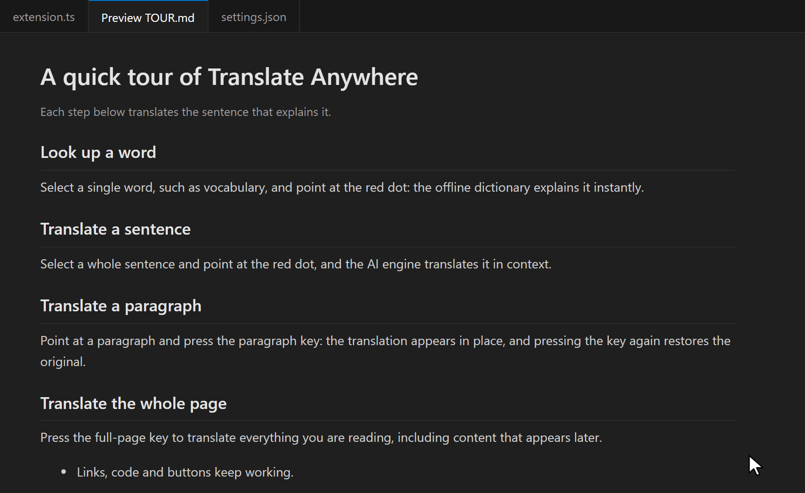
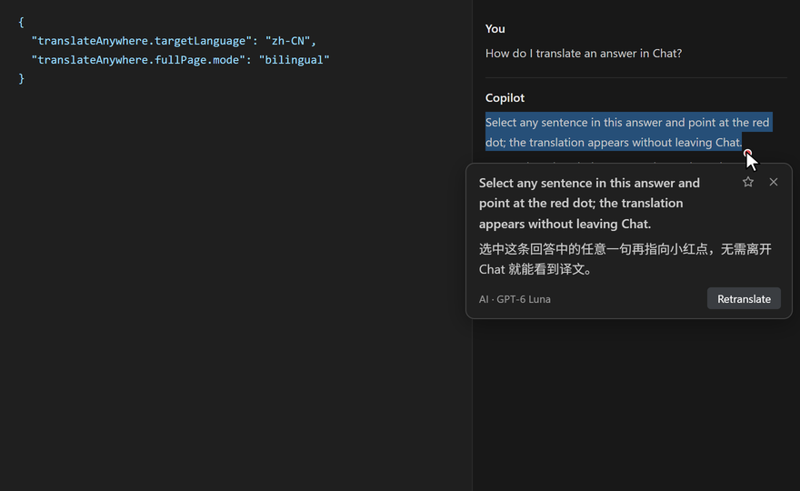

# Translate Anywhere - VS Code Translator for Chat & Markdown

**English** | [简体中文](README.zh-CN.md)

Translate what you read in VS Code: **Chat**, the **Agents window**, **Markdown preview**, **Release Notes**, **Settings**, extension pages and other built-in pages, plus the pages and views of **other extensions** (webview panels, sidebar views, custom editors such as a PDF viewer). Select text and hover the small red dot, press **Alt+Z** for the paragraph under the mouse, or **Alt+W** for the whole page.

- **Words** come from an offline dictionary.
- **Phrases, sentences and pages** go to the engine you choose: an AI model (GitHub Copilot through VS Code, or your own OpenAI, Claude, Gemini, DeepSeek, Qwen… key), a token-free online service, or nothing at all in offline-only mode.
- **Text editors are never touched.** Nothing happens while you write code.

<picture></picture>

> Inspired by the reading experience of the [Immersive Translate](https://chromewebstore.google.com/detail/immersive-translate-ai-we/bpoadfkcbjbfhfodiogcnhhhpibjhbnh) browser extension. Not affiliated with or endorsed by it. The screenshots are rendered from the extension's real UI on demo pages.

## Quick start

1. Install the extension.
2. Click **Enable…** in the welcome notification, or **Enable / Repair** in the Translate Anywhere sidebar (the **文A** icon in the Activity Bar). Read the disclosure and confirm: the extension adds a small, reversible script to VS Code's own UI files ([details](#how-the-integration-works)).
3. Reload the window when prompted.
4. Click **Try it on a sample page** in the sidebar, or select text in Chat or a Markdown preview and hover the red dot.
5. Choose a [translation engine](#translation-engines). The default is AI through **VS Code language models**: pick a model in the sidebar. The first AI translation asks for permission to use the model; if you dismissed that prompt, click **Allow access** in the sidebar.

## Features

| Feature | How |
| --- | --- |
| **Select & hover** | Select text, then hover the red dot. Words use the offline dictionary; anything else uses the selected engine. Click ☆ to save the entry to your vocabulary book. |
| **Paragraph translation** | Hover a paragraph and press **Alt+Z**. Press again to remove the translation. |
| **Full-page translation** | Press **Alt+W** to translate the Chat conversation, preview or page you are working in; press again to restore. Show the translation only (default) or both languages. |
| **Other extensions too** | Any extension page built on a webview (dashboards, release hubs, sidebar views, custom editors such as a PDF viewer) works like a built-in page: select & hover, **Alt+Z** and **Alt+W**. No per-extension setup. Code, inputs and buttons keep working. |
| **Three engines** | AI, token-free online translation (Google Translate or MyMemory), or the offline dictionary only. |
| **Settings sidebar** | Engines, models, API keys, shortcuts, the look of the dot, vocabulary and dictionaries in one panel. |
| **Markdown as preview** | One click in the sidebar makes `.md` files open as a rendered preview by default; **Open as text again** undoes it. |
| **Your languages** | 20 target languages. The interface is in English, Simplified Chinese or German and follows VS Code by default. |

| Dictionary | AI translation |
| --- | --- |
| <picture></picture> | <picture></picture> |
| **Chat** | **Full page (Alt+W)** |
| <picture></picture> | <picture></picture> |

## Where it works

Each surface can be switched off under **Where to translate…** in the sidebar footer (`translateAnywhere.surfaces`):

| Surface | Includes |
| --- | --- |
| Markdown preview | The built-in preview. |
| Release Notes | Including the **In this update** contents. |
| Chat | Chat and the separate Agents window: responses, agent questions with their selectable options and answer summaries, tool confirmations and input notices. |
| Settings | Settings and Keyboard Shortcuts editors. |
| Extension pages | Extension details pages (README and changelog) and pages and views of any other extension that uses a webview, such as panels, sidebar views and custom editors (for example a PDF viewer). Text the page draws invisibly (like the selectable layer over a PDF page) can be selected and looked up but is not translated in place. |
| Welcome | Welcome page and walkthroughs. |
| Workbench UI | Notifications, dialogs, hover cards, the Workspace Trust page and view messages. |

## Shortcuts and full-page translation

| Shortcut | Action |
| --- | --- |
| **Alt+Z** | Translate or restore the paragraph under the mouse. |
| **Alt+W** | Translate or restore the whole page you are working in. |

- On macOS, Option works as Alt (Option+Z, Option+W).
- The shortcuts work only while the mouse is over a supported page. Elsewhere the key keeps its VS Code meaning; for example, `Alt+Z` still toggles word wrap in an editor.
- They are handled inside the page, so change them in the sidebar (click a key and press a new combination; Backspace turns it off) or in settings, not in *Keyboard Shortcuts*. Format: modifiers joined with `+` and one letter, digit, F1–F24, `Space` or `` ` ``, such as `Ctrl+Shift+Y` or `F8`.
- Paragraph and full-page translation need the AI or online engine; offline-only mode translates single words only.

Full-page translation keeps the page working:

- **Translation only** replaces the text in place. Links, clickable settings, inline code, keys, icons, checkboxes and buttons are the page's original elements, so they look and behave as before.
- **Bilingual** adds a translated copy under each paragraph. Links in the copy work, and other controls forward to the original.
- Code blocks, editors, inputs and text already in the target language are left alone. Paragraphs are translated as they scroll into view, including content that appears later.
- If an engine drops a paragraph's format markers, that paragraph is shown bilingually so its links are not lost.

## Translation engines

Choose the engine under **Translation** in the sidebar (`translateAnywhere.translation.engine`). Dictionary hits are always answered locally, and a failing engine never falls back to another service.

### AI (default)

| Provider | API | Default model | Get a key |
| --- | --- | --- | --- |
| **VS Code language models** *(default)* | VS Code Language Model API | none; you choose | none; uses e.g. your GitHub Copilot subscription |
| OpenAI | OpenAI | `gpt-4o-mini` | [platform.openai.com](https://platform.openai.com/api-keys) |
| Anthropic Claude | Anthropic Messages | `claude-haiku-4-5` | [console.anthropic.com](https://console.anthropic.com/settings/keys) |
| Google Gemini | OpenAI-compatible | `gemini-2.5-flash-lite` | [aistudio.google.com](https://aistudio.google.com/apikey) |
| DeepSeek | OpenAI-compatible | `deepseek-chat` | [platform.deepseek.com](https://platform.deepseek.com/api_keys) |
| Alibaba Qwen (DashScope) | OpenAI-compatible | `qwen-flash` | [bailian.console.aliyun.com](https://bailian.console.aliyun.com/?apiKey=1) |
| Moonshot Kimi | OpenAI-compatible | `moonshot-v1-8k` | [platform.moonshot.cn](https://platform.moonshot.cn/console/api-keys) |
| Zhipu GLM | OpenAI-compatible | `glm-4-flash` | [open.bigmodel.cn](https://open.bigmodel.cn/usercenter/apikeys) |
| SiliconFlow | OpenAI-compatible | `Qwen/Qwen2.5-7B-Instruct` | [cloud.siliconflow.cn](https://cloud.siliconflow.cn/account/ak) |
| OpenRouter | OpenAI-compatible | `openai/gpt-4o-mini` | [openrouter.ai](https://openrouter.ai/keys) |
| Groq | OpenAI-compatible | `llama-3.1-8b-instant` | [console.groq.com](https://console.groq.com/keys) |
| Mistral AI | OpenAI-compatible | `mistral-small-latest` | [console.mistral.ai](https://console.mistral.ai/api-keys) |
| Ollama (local) | OpenAI-compatible | `qwen2.5:3b` | no key; runs on `http://localhost:11434` |
| Custom | OpenAI-compatible | *(you set it)* | any compatible endpoint: LM Studio, vLLM, one-api, an Azure gateway… |

**VS Code language models**

- The list shows the models you can pick in the Chat model picker you currently use (including Copilot CLI sessions and the Agents window), in VS Code's order. There is no Auto choice.
- No model is chosen for you. Until you pick one, each request borrows a small, fast visible model (luna, haiku, flash, mini…) and labels the result as temporary; nothing is saved. A model chosen on another computer arrives through Settings Sync.
- A saved model that you hide later stays selected and is marked **hidden**; one that is no longer available is marked **not available** until you choose another.
- **Test speed** measures each visible, authorized model (one warm-up, three timed runs, median shown); the fastest lightweight model then marks the ones suited to translation as **Recommended**. It runs only when you click it, and requests to premium models count toward your Copilot premium-request quota.

**API providers**

- **Fetch list** loads the provider's models, or type any model name. Only lightweight models are suggested by default: translation needs speed, not reasoning.
- **Base URL** overrides the endpoint for proxies, regional endpoints such as `https://dashscope-intl.aliyuncs.com/compatible-mode/v1`, or self-hosted gateways. It is required for **Custom**.
- API keys are stored per provider in VS Code's encrypted [Secret Storage](https://code.visualstudio.com/api/references/vscode-api#SecretStorage), never in `settings.json`, and are not synced. Use **Set key** in the sidebar or **Translate Anywhere: Set API Key**.

### Online (no API key)

- **Google Translate (experimental):** an unofficial endpoint, not the supported Cloud API. It may stop working or be blocked; corporate proxies often reject it.
- **MyMemory:** a documented anonymous API with 5,000 characters per day.
- Each service needs a one-time local permission, which you can revoke. The source language is detected automatically unless you set it.
- If AI mode finds no Copilot or VS Code model, it offers to switch to online translation, set up an AI API or use the offline dictionary only.
- Research, setup, privacy and limitations: [docs/ONLINE-TRANSLATION.md](docs/ONLINE-TRANSLATION.md).

### Offline dictionary

- English → Chinese: [ECDICT](https://github.com/skywind3000/ECDICT), about 770,000 entries (15 MB compressed).
- German → Chinese: derived from [HanDeDict](https://handedict.zydeo.net/), about 130,000 entries (3 MB), downloaded on the first German lookup. Turn it off with `translateAnywhere.dictionary.german`.
- Dictionaries provide Chinese definitions only; other target languages use the selected engine.

Ways to get the dictionaries:

| Option | How |
| --- | --- |
| **Automatic download** *(default)* | Downloaded once on first use from GitHub Releases, with jsDelivr and raw.githubusercontent as fallbacks, and verified with SHA-256. |
| **Offline VSIX** | Download `vscode-translate-anywhere-offline-<version>.vsix` (one package for every platform) from [GitHub Releases](https://github.com/MusingZone/vscode-translate-anywhere/releases) and run **Extensions: Install from VSIX…**. No network access is needed. |
| **Local file** | Click **Choose file…** in the sidebar (or set `translateAnywhere.dictionary.path`) to use a `dictionary.json.gz` you downloaded or built with `tools/build.py`. |

Behind a firewall, set `translateAnywhere.dictionary.downloadUrl` to an internal HTTPS mirror of the same file. Set `translateAnywhere.dictionary.autoDownload` to `false` to never download the English dictionary.

## Settings sidebar

<picture></picture>

Click the **文A** icon in the Activity Bar:

- **Integration**: status, **Enable / Repair**, **Disable & Restore**.
- **Shortcuts & how to use**: change shortcuts, **Try it on a sample page**, and open Markdown as a preview by default. Click the dot to change its size, color, border, opacity and shape, or use your own image (PNG, JPG, GIF, WebP, SVG).
- **Translation**: engine, target language, full-page display mode, automatic translation of dictionary misses.
- **Online translation** or **AI engine**, depending on the engine: service and permission, or provider, model, **Test speed** / **Fetch list**, API key and base URL.
- **Vocabulary**: your latest entries; open, export to CSV, remove.
- **Offline dictionary**: status, **Download**, **Choose file…**, **Use default**.
- Footer: **Where to translate…**, all settings, log.

All values except API keys and online-service permissions are ordinary settings under **Settings → Extensions → Translate Anywhere** and sync with Settings Sync.

 

## Settings

Changes apply within a few seconds without reloading.

| Setting | Default | Description |
| --- | --- | --- |
| `translateAnywhere.translation.engine` | `ai` | `ai`, `online` or `offline`. Dictionary hits stay local in every mode. |
| `translateAnywhere.targetLanguage` | `zh-CN` | Language to translate into. |
| `translateAnywhere.uiLanguage` | `auto` | Interface language: `auto` (follows VS Code), `en`, `zh-CN` or `de`. |
| `translateAnywhere.surfaces` | all on | Switch each [surface](#where-it-works) on or off. |
| `translateAnywhere.shortcuts.paragraph` | `Alt+Z` | Paragraph shortcut. Empty disables it. |
| `translateAnywhere.shortcuts.fullPage` | `Alt+W` | Full-page shortcut. Empty disables it. |
| `translateAnywhere.fullPage.mode` | `translationOnly` | `translationOnly` or `bilingual`. |
| `translateAnywhere.dot.size` / `color` / `borderWidth` / `borderColor` / `opacity` / `shape` | `7` / `#e5484d` / `1` / `#ffffff` / `0.85` / `circle` | Look of the selection dot. Easier from the sidebar: click the dot. |
| `translateAnywhere.ai.autoTranslate` | `true` | Use the selected engine automatically when the dictionary has no entry; when off, click the translate button in the popup. Ignored in offline-only mode. |
| `translateAnywhere.ai.provider` | `vscode` | AI provider (see [AI](#ai-default)). |
| `translateAnywhere.ai.modelId` | *(empty)* | VS Code language model. Empty until you choose one; each request then borrows a lightweight model. |
| `translateAnywhere.ai.apiModel` | *(empty)* | Model for API providers. Empty means the provider's default. |
| `translateAnywhere.ai.baseUrl` | *(empty)* | Endpoint override for API providers; required for **Custom**. |
| `translateAnywhere.online.provider` | `google` | `google` (experimental) or `mymemory`. Each needs its own local permission. |
| `translateAnywhere.online.sourceLanguage` | `auto` | Automatic detection or an explicit source language. |
| `translateAnywhere.dictionary.autoDownload` | `true` | Download the English–Chinese dictionary on first use. |
| `translateAnywhere.dictionary.path` | *(empty)* | Use a local dictionary file. |
| `translateAnywhere.dictionary.downloadUrl` | *(empty)* | Extra HTTPS mirror tried first. |
| `translateAnywhere.dictionary.german` | `true` | Look up German words in the German–Chinese dictionary (downloaded on first use). |
| `translateAnywhere.integration.enabled` | `false` | Consent to the [UI integration](#how-the-integration-works). |
| `translateAnywhere.integration.autoRepair` | `true` | Reapply the integration after VS Code updates. |

## Commands

All commands are under **Translate Anywhere:** in the Command Palette; most are also buttons in the sidebar.

| Command | Purpose |
| --- | --- |
| Enable / Repair Integration · Disable and Restore VS Code | Apply, repair or remove the UI integration. |
| Select AI Provider · Select AI Model · Set API Key · Authorize AI Model | Configure the AI engine. |
| Allow Online Translation Service · Revoke Online Translation Permission | Manage local permission for the selected online service. |
| Download Dictionary · Use Local Dictionary File… · Use Default Dictionary | Manage the offline dictionaries. |
| Try It on a Sample Page · Customize the Selection Dot · Choose Where to Translate · Open Markdown Files as Preview by Default · Open Markdown Files as Text by Default | Getting started and reading comfort. |
| Open Vocabulary · Export Vocabulary to CSV · Remove Vocabulary Entries | Manage saved entries. |
| Open the Sidebar · Open Settings · Show Status · Show Log | Settings and diagnostics. |

## Privacy and security

- **No telemetry.** The extension collects and sends no usage data.
- **Dictionary lookups are local.** The only dictionary network access is the one-time download; the offline VSIX and local files need none.
- **AI translation** sends the selected text, or the paragraph or page being translated, only to the provider you chose: through VS Code's Language Model API (for example GitHub Copilot, under its terms), directly over HTTPS with your key, or to a local endpoint such as Ollama.
- **Online translation** sends text directly to the chosen service only after you allow it on this computer. MyMemory may retain submitted text and share it with translation partners, and query parameters can appear in service or proxy logs. Do not send confidential text or code; revoking permission cannot recall text already sent.
- **Offline dictionary only** never calls AI or online translation.
- Paragraph and page translation send visible text with short markers such as `<g1>…</g1>` where links and other inline elements sit. Link targets, code and setting IDs are not sent.
- The injected UI talks to the extension through a bridge on `127.0.0.1:17865`, protected by a random per-installation token and an origin check. On shared computers, prefer a per-user VS Code installation.
- Your vocabulary is stored locally in the extension's global storage.

Details: [SECURITY.md](SECURITY.md) and [docs/ONLINE-TRANSLATION.md](docs/ONLINE-TRANSLATION.md).

## How the integration works

VS Code gives extensions no API to read selections or draw popups inside Chat, Release Notes, Settings or the built-in Markdown preview. After you consent, the extension therefore **adds a small script to VS Code's own UI files**:

- `out/vs/workbench/workbench.desktop.main.js`
- `out/vs/code/electron-browser/workbench/workbench.html`
- the Agents window's `out/vs/sessions/sessions.desktop.main.js` and `out/vs/sessions/electron-browser/sessions.html` (VS Code versions that have it)
- the webview `index.html`
- the matching `checksums` in `product.json`

Safeguards:

- Nothing is changed until you enable the integration (`translateAnywhere.integration.enabled` defaults to `false`).
- Original files are backed up byte for byte in the extension's global storage. Patches are applied atomically, and files changed by anyone else are never overwritten.
- **Disable and Restore VS Code** restores the originals. After a VS Code update replaces the files, the integration is reapplied automatically (`translateAnywhere.integration.autoRepair`); one reload is enough.
- If the installation folder is not writable by you, each patch operation asks once for administrator confirmation (UAC on Windows, the password dialog on macOS, polkit `pkexec` on Linux). No service, scheduled task or persistent elevated process is created.
- Because the checksums are updated, VS Code does not report a "corrupt installation". After disabling, the warning may appear once until VS Code is fully restarted.

## Troubleshooting

| Symptom | What to do |
| --- | --- |
| No red dot appears | Check the integration status in the sidebar, click **Enable / Repair** and reload the window. Make sure the surface is on under **Where to translate…**. |
| Alt+Z / Alt+W does nothing | Move the mouse over the page or Chat response first, check the shortcuts in the sidebar, and make sure the engine is not offline-only. |
| AI translation fails | Click **Allow access** next to the model, choose another model, or switch to the online engine. **Show Log** has the details. |
| Google translation is rejected | Common behind corporate proxies; switch the online service to MyMemory. |
| In "translation only" mode a paragraph shows both languages | The engine dropped the paragraph's format markers, so it was shown bilingually to keep its links. Try another model or service. |
| "Corrupt installation" warning after disabling | Fully quit and restart VS Code once. |
| "Installation changed outside this extension" after an update | Close windows that still run an older extension version, run **Enable / Repair Integration** and reload. Genuine external edits require restoring or reinstalling VS Code. |

## Requirements and limitations

- Desktop VS Code 1.100 or newer on **Windows** (x64, ARM64), **macOS** (Apple Silicon, Intel) or **Linux** (x64, ARM64, ARMhf). Not available in VS Code for the Web or Codespaces in the browser; in remote windows (SSH, WSL, containers) it runs locally as a UI extension.
- Needs write access to the VS Code installation folder; system-wide installations ask for administrator confirmation.
- **macOS:** run VS Code from */Applications*. Started from *Downloads* or a disk image, macOS runs a read-only copy (App Translocation) that cannot be integrated. Modifying the app bundle invalidates its code signature seal; VS Code still starts, and **Disable** restores the original files.
- **Linux:** `.deb`/`.rpm` installations under `/usr/share/code` need a polkit agent for the administrator prompt; without one, the extension offers a terminal command to copy. **Snap** and **Flatpak** installations are read-only; use the `.deb`, `.rpm` or `.tar.gz` build.
- The bridge uses local port `17865`. If several users of one computer run VS Code at the same time, only the first one gets translations.
- Future VS Code UI changes can break individual surfaces until the extension is updated.
- Online services may be blocked or rate-limited. MyMemory's daily quota is small for heavy full-page use.

## Uninstalling

Uninstalling restores VS Code's original files after the next full restart. To restore immediately, click **Disable & Restore** in the sidebar (or run **Disable and Restore VS Code**) before uninstalling. Always do this first if enabling needed administrator confirmation: the automatic restore after uninstalling runs without administrator rights. Reinstalling or updating VS Code also removes the integration.

## Contributing

Issues and pull requests are welcome at [github.com/MusingZone/vscode-translate-anywhere](https://github.com/MusingZone/vscode-translate-anywhere). See [CONTRIBUTING.md](CONTRIBUTING.md) for the development setup, tests (`npm test`, plus headless UI tests in `tools/`) and how to add an interface language. Release history: [CHANGELOG.md](CHANGELOG.md).

If the extension helps you, a rating on the [Marketplace](https://marketplace.visualstudio.com/items?itemName=MusingZone.vscode-translate-anywhere&ssr=false#review-details) helps others find it.

## Credits

- English → Chinese dictionary: [ECDICT](https://github.com/skywind3000/ECDICT) by skywind3000, MIT License.
- German → Chinese dictionary: derived from [HanDeDict](https://handedict.zydeo.net/), CC BY-SA 3.0.
- See [THIRD-PARTY-NOTICES.md](THIRD-PARTY-NOTICES.md).

## License

Extension code: [MIT](LICENSE.txt). The German–Chinese dictionary data (`data/dictionary-de.json.gz`) is licensed under [CC BY-SA 3.0](data/HanDeDict-LICENSE.txt).
