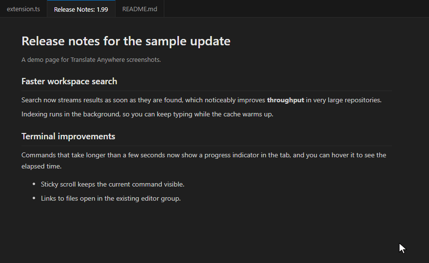
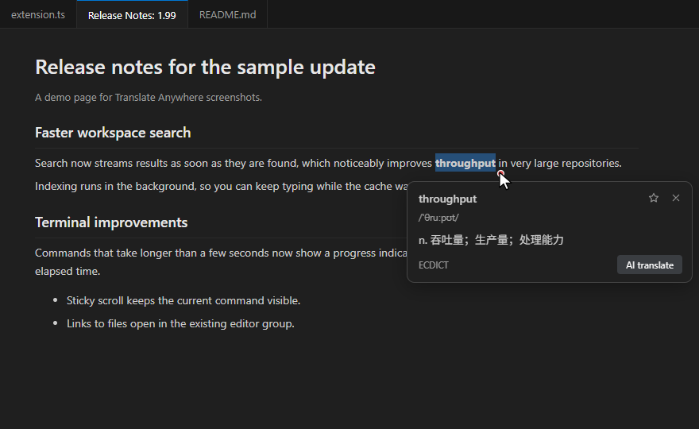
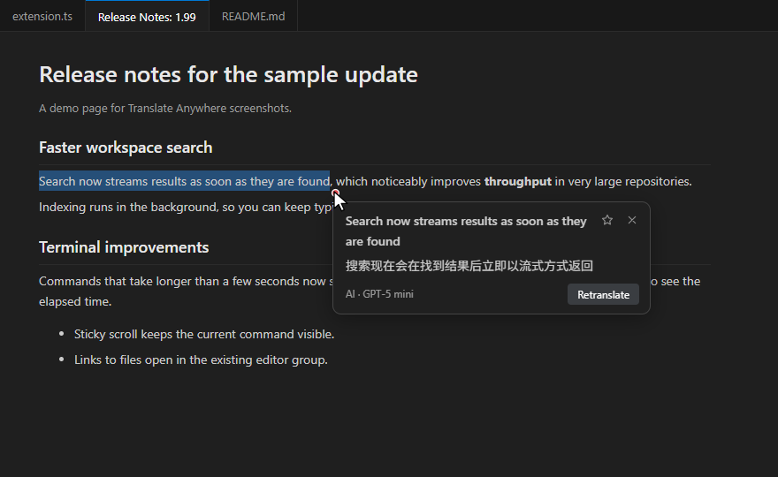
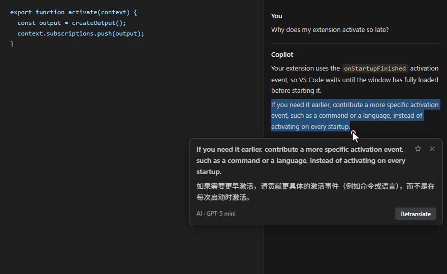
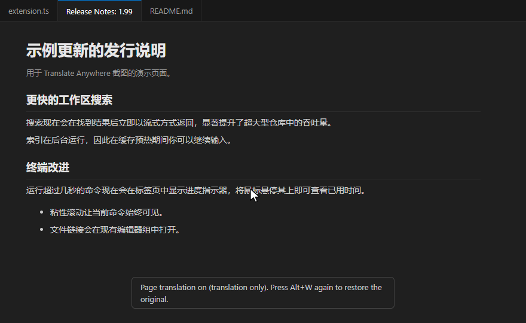
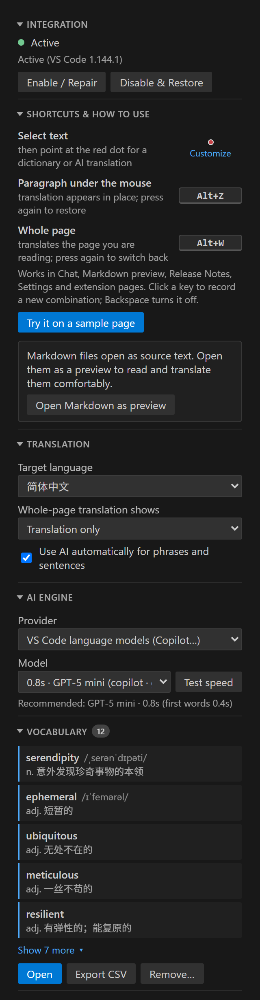

# Translate Anywhere - Select & Hover Translator

**English** | [简体中文](README.zh-CN.md)

Select text in VS Code's **Chat**, **Markdown preview**, **Release Notes**, **Settings**, **extension pages** and other built-in pages. A small red dot appears next to the selection; hover it for an instant translation. Single words come from an offline dictionary (English → Chinese); phrases, sentences and paragraphs are translated by the AI model you choose: GitHub Copilot through VS Code, or OpenAI, Claude, Gemini, DeepSeek, Qwen and other providers with your own API key.

Text editors are never touched. The extension does nothing while you edit code.

<picture></picture>

> Inspired by the reading experience of browser "immersive translation" extensions. Not affiliated with or endorsed by any of them. The screenshots are rendered from the extension's real UI on demo pages.

## Features

| Feature | How |
| --- | --- |
| **Select & hover translation** | Select text, then hover the red dot. Words use the offline dictionary (English → Chinese). Anything longer, or other target languages, uses AI automatically. |
| **Paragraph translation** | Hover a paragraph and press **Alt+Z**. Press again to remove the translation. When you select a long passage, the popup shows a one-line hint about this shortcut (a few times at most). |
| **Full-page translation** | Press **Alt+W** to translate the Chat conversation, preview or page you are working in. Press again to restore. "Translation only" (default) or "bilingual" display. |
| **Many AI providers** | VS Code language models (GitHub Copilot, no key needed), OpenAI, Anthropic Claude, Google Gemini, DeepSeek, Qwen, Kimi, GLM, SiliconFlow, OpenRouter, Groq, Mistral, Ollama, or any OpenAI-compatible endpoint. |
| **Settings sidebar** | Everything in one panel in the Activity Bar: shortcuts with a sample page to try them, provider and model lists, API keys, vocabulary and dictionary. |
| **Markdown as preview** | One click in the sidebar makes `.md` files open as a rendered preview by default, which is easier to read and translate. **Open as text again** undoes it. |
| **Vocabulary book** | Click ☆ in the popup to save a word or sentence. The sidebar shows your latest entries and unfolds more in place; open, export to CSV or remove them. |
| **Your language** | 20 target languages; the UI follows your VS Code display language. |

| Dictionary | AI translation |
| --- | --- |
| <picture></picture> | <picture></picture> |
| **Chat** | **Full page (Alt+W)** |
| <picture></picture> | <picture></picture> |

### Supported surfaces

Each surface can be switched off with `translateAnywhere.surfaces` (sidebar footer → **Where to translate…**):

- Markdown preview
- Release Notes
- Chat (responses, the question box shown when an agent asks you something, tool confirmations and input notices)
- Settings and Keyboard Shortcuts editors
- Extension details pages (README and changelog)
- Welcome page and walkthroughs
- Notifications, dialogs, workbench hover cards, the Workspace Trust page and view messages

## Getting started

1. Install the extension.
2. Click **Enable…** in the welcome notification, or click **Enable / Repair** in the Translate Anywhere sidebar. Read the disclosure, then confirm.
3. Reload the window when prompted.
4. Click **Try it on a sample page** in the sidebar, or select some text in Chat or a Markdown preview, then hover the red dot.
5. AI engine: with **VS Code language models** (the default), the extension picks a lightweight model (luna, haiku, flash, mini…) among the ones VS Code's model picker shows you; models you hid in the **Language Models** view are never used. If none matches, the sidebar asks you to choose one. The first AI translation asks for permission to use the model; if you dismissed that prompt, click **Allow access** next to the model in the sidebar.

## Settings sidebar

<picture></picture>

Click the **文A** icon in the Activity Bar. The sidebar shows:

- **Integration status**, with **Enable / Repair** and **Disable & Restore**.
- **Shortcuts & how to use**: what select, **Alt+Z** and **Alt+W** do. Click the dot to customize it: size, color, border, opacity, shape, or your own image (PNG, JPG, GIF, WebP, SVG), with a live preview. Click a key and press a new combination to change it; Backspace turns it off. **Try it on a sample page** opens a practice page, and a card offers to open Markdown files as a preview by default.
- **Translation**: target language, full-page display mode, automatic AI.
- **AI engine**:
  - provider list;
  - model list: the models VS Code's model picker shows you, in its order, and **Auto** as an explicit choice. **Speed test** warms up each model once and times three runs and shows the median;   then the fastest lightweight model among them picks the ones suited to translation, which appear as **Recommended**, with **Use it**. It never runs by itself; requests to premium models count toward your Copilot premium-request quota, so hide models you never use in VS Code's **Language Models** view. API providers get **Fetch list** instead;
  - API key status with a link to the provider's key page;
  - an optional base URL.
  - **Vocabulary**: your five latest entries; **Show N more** unfolds the rest in place (the full list opens in an editor); open, export, remove.
- **Offline dictionary**: status, Download, Choose file, Use default.
- Footer: **Where to translate…** (per-surface switches), all settings, log.

All values are ordinary VS Code settings, so they also appear in **Settings → Extensions → Translate Anywhere** and sync with Settings Sync; links there jump to the matching control in the sidebar. API keys are the exception: they never leave VS Code's Secret Storage.

 

## AI providers

| Provider | API | Default (lightweight) model | Get a key |
| --- | --- | --- | --- |
| **VS Code language models** *(default)* | VS Code Language Model API | a visible lightweight model (luna, haiku, flash, mini…) | none; uses e.g. your GitHub Copilot subscription |
| OpenAI | OpenAI | `gpt-4o-mini` | [platform.openai.com](https://platform.openai.com/api-keys) |
| Anthropic Claude | Anthropic Messages | `claude-haiku-4-5` | [console.anthropic.com](https://console.anthropic.com/settings/keys) |
| Google Gemini | OpenAI-compatible | `gemini-2.5-flash-lite` | [aistudio.google.com](https://aistudio.google.com/apikey) |
| DeepSeek | OpenAI-compatible | `deepseek-chat` | [platform.deepseek.com](https://platform.deepseek.com/api_keys) |
| Alibaba Qwen (DashScope) | OpenAI-compatible | `qwen-flash` | [bailian.console.aliyun.com](https://bailian.console.aliyun.com/?apiKey=1) |
| Moonshot Kimi | OpenAI-compatible | `moonshot-v1-8k` | [platform.moonshot.cn](https://platform.moonshot.cn/console/api-keys) |
| Zhipu GLM | OpenAI-compatible | `glm-4-flash` | [open.bigmodel.cn](https://open.bigmodel.cn/usercenter/apikeys) |
| SiliconFlow | OpenAI-compatible | `Qwen/Qwen2.5-7B-Instruct` | [cloud.siliconflow.cn](https://cloud.siliconflow.cn/account/ak) |
| OpenRouter | OpenAI-compatible | `openai/gpt-4o-mini` | [openrouter.ai](https://openrouter.ai/keys) |
| Groq | OpenAI-compatible | `llama-3.1-8b-instant` | [console.groq.com](https://console.groq.com/keys) |
| Mistral AI | OpenAI-compatible | `mistral-small-latest` | [console.mistral.ai](https://console.mistral.ai/api-keys) |
| Ollama (local) | OpenAI-compatible | `qwen2.5:3b` | no key; runs on `http://localhost:11434` |
| Custom | OpenAI-compatible | *(you set it)* | any compatible endpoint: LM Studio, vLLM, one-api, an Azure gateway… |

- Change the model in the sidebar. **Fetch list** loads the provider's model list; you can also type any model name.
- **Base URL** overrides the endpoint. Use it for proxies, regional endpoints such as `https://dashscope-intl.aliyuncs.com/compatible-mode/v1`, or self-hosted gateways.
- Model names change often. If a default stops working, pick another model from the list.
- Only lightweight models are suggested by default: translation needs speed, not reasoning.

**API keys** are stored with VS Code's encrypted [Secret Storage](https://code.visualstudio.com/api/references/vscode-api#SecretStorage), one per provider. They are never written to `settings.json` and are not synced. Set or clear them with **Set key** in the sidebar or **Translate Anywhere: Set API Key**.

## Offline dictionary

The English → Chinese dictionary is [ECDICT](https://github.com/skywind3000/ECDICT): 770,000 entries, 15 MB compressed. There are three ways to get it:

| Option | How |
| --- | --- |
| **Automatic download** *(default)* | On first use the dictionary is downloaded once, from GitHub Releases with jsDelivr and raw.githubusercontent mirrors as fallbacks, and checked with SHA-256. Until it is ready, every selection uses AI. |
| **Offline VSIX** | Download `vscode-translate-anywhere-offline-<version>.vsix` (one package for every platform) from [GitHub Releases](https://github.com/MusingZone/vscode-translate-anywhere/releases) and run **Extensions: Install from VSIX…**. No network access is needed. |
| **Local file** | Click **Choose file…** in the sidebar (or set `translateAnywhere.dictionary.path`) to use a `dictionary.json.gz` you downloaded or built yourself with `tools/build.py`. |

Behind a firewall, set `translateAnywhere.dictionary.downloadUrl` to an internal HTTPS mirror of the same file. Set `translateAnywhere.dictionary.autoDownload` to `false` to never download.

## How it works (please read)

VS Code does not give extensions an API to read selections or draw popups inside Chat, Release Notes, Settings or the built-in Markdown preview. To make this possible, the extension **adds a small script to VS Code's own UI files**:

- `out/vs/workbench/workbench.desktop.main.js`
- `out/vs/code/electron-browser/workbench/workbench.html`
- the webview `index.html`
- the matching `checksums` in `product.json`

Safeguards:

- Nothing is changed until you explicitly enable the integration (`translateAnywhere.integration.enabled` defaults to `false`).
- Original files are backed up byte-for-byte in the extension's global storage. The patch is applied atomically and refuses to overwrite files it did not write.
- **Disable and Restore VS Code** restores the originals. The restore also runs automatically when the extension is uninstalled, after VS Code restarts.
- After a VS Code update replaces the files, the integration is reapplied automatically (`translateAnywhere.integration.autoRepair`).
- If the VS Code installation folder is not writable by you, each patch operation asks for administrator confirmation once: UAC on Windows, the system password dialog on macOS, the polkit (`pkexec`) dialog on Linux. No persistent service or scheduled task is created, and the files the extension keeps are handed back to your user account.
- Because checksums are updated, VS Code does not report a "corrupt installation". After **disabling**, the warning may appear once until VS Code is fully restarted.

## Settings

| Setting | Default | Description |
| --- | --- | --- |
| `translateAnywhere.targetLanguage` | `zh-CN` | Language to translate into. |
| `translateAnywhere.uiLanguage` | `auto` | Popup, sidebar and message language. `auto` follows VS Code. |
| `translateAnywhere.surfaces` | all on | Enable or disable each supported surface. |
| `translateAnywhere.shortcuts.paragraph` | `Alt+Z` | Paragraph shortcut. Empty disables it. |
| `translateAnywhere.shortcuts.fullPage` | `Alt+W` | Full-page shortcut. Empty disables it. |
| `translateAnywhere.dot.size` / `color` / `borderWidth` / `borderColor` / `opacity` / `shape` | `7` / `#e5484d` / `1` / `#ffffff` / `0.85` / `circle` | Look of the selection dot. Easier from the sidebar: click the dot. |
| `translateAnywhere.fullPage.mode` | `translationOnly` | `translationOnly` or `bilingual`. |
| `translateAnywhere.ai.autoTranslate` | `true` | Use AI automatically when the dictionary has no entry. |
| `translateAnywhere.ai.provider` | `vscode` | AI provider (see the table above). |
| `translateAnywhere.ai.modelId` | *(empty)* | VS Code language model ID. Filled in with a visible lightweight model on first use. `@auto` uses the fastest recommended model after a speed test, otherwise a lightweight one. |
| `translateAnywhere.ai.apiModel` | *(empty)* | Model for API providers. Empty means the provider's default. |
| `translateAnywhere.ai.baseUrl` | *(empty)* | Endpoint override for API providers. |
| `translateAnywhere.dictionary.autoDownload` | `true` | Download the dictionary on first use. |
| `translateAnywhere.dictionary.path` | *(empty)* | Use a local dictionary file. |
| `translateAnywhere.dictionary.downloadUrl` | *(empty)* | Extra HTTPS mirror tried first. |
| `translateAnywhere.integration.enabled` | `false` | Consent for the UI integration described above. |
| `translateAnywhere.integration.autoRepair` | `true` | Reapply after VS Code updates. |

Changes apply within a few seconds without reloading.

**About shortcuts.** The paragraph and full-page shortcuts are handled inside the page itself, so they are configured in the sidebar or the settings above rather than in *Keyboard Shortcuts*.
- Format: modifiers joined with `+` and one key, such as `Alt+Z`, `Ctrl+Shift+Y` or `F8`.
- Supported keys: letters, digits, F1–F24, `Space` and `` ` ``.
- When the mouse is not over a supported page, the key keeps its normal VS Code meaning; for example, `Alt+Z` toggles word wrap in an editor.

## Commands

All commands are under **Translate Anywhere:** in the Command Palette. Most are also buttons in the sidebar.

| Command | Purpose |
| --- | --- |
| Enable / Repair Integration · Disable and Restore VS Code | Apply, repair or remove the UI integration. |
| Select AI Provider · Select AI Model · Set API Key · Authorize AI Model | Configure the AI engine. |
| Download Dictionary · Use Local Dictionary File… · Use Default Dictionary | Manage the offline dictionaries. |
| Try It on a Sample Page · Open Markdown Files as Preview by Default · Open Markdown Files as Text by Default · Choose Where to Translate | Getting started and reading comfort. |
| Open Vocabulary · Export Vocabulary to CSV · Remove Vocabulary Entries | Manage saved words. |
| Open the Sidebar · Open Settings · Show Status · Show Log | Settings and diagnostics. |

## Privacy

- **No telemetry.** The extension collects and sends no usage data.
- **Dictionary lookups are offline.** The only dictionary-related network access is the one-time downloads described above. The offline VSIX and the local-file option need none.
- **AI translation** sends only the selected text, or the paragraph or page being translated, to the provider you selected:
  - VS Code language models are called through VS Code's Language Model API, and that provider's terms apply (for example GitHub Copilot's).
  - API providers are called directly over HTTPS with your key, and their terms and data policies apply.
  - Ollama and other local endpoints keep everything on your machine.
  - Turn off `translateAnywhere.ai.autoTranslate` if you want AI to run only when you click **AI translate**.
- The UI talks to the extension through an HTTP bridge bound to `127.0.0.1` only. It is protected by a random per-installation token and checks the request origin.
- Your vocabulary is stored locally in VS Code's global storage folder for this extension.

## Requirements and limitations

- **Windows** (x64, ARM64), **macOS** (Apple Silicon, Intel) and **Linux** (x64, ARM64, ARMhf). Desktop VS Code Stable 1.100 or newer; Insiders usually works too.
- **macOS:** Option works as Alt, so the default shortcuts are Option+Z and Option+W. Run VS Code from */Applications*: when it runs from *Downloads* or a mounted disk image, macOS starts it from a read-only copy (App Translocation) that cannot be integrated. Modifying the app bundle invalidates its code signature seal; VS Code still starts normally, and **Disable** restores the original files.
- **Linux:** `.deb`/`.rpm` installs under `/usr/share/code` need a polkit agent for the administrator prompt (present on standard desktops). If none is available, the extension offers a terminal command to copy. **Snap** and **Flatpak** installations are read-only and cannot be integrated; use the `.deb`, `.rpm` or `.tar.gz` build instead.
- Not available in VS Code for the Web or Codespaces browser sessions. In remote windows (SSH, WSL, containers) the extension runs on your local machine as a UI extension.
- Requires write access to the VS Code installation folder. For system-wide installs this means administrator confirmation.
- The bridge uses local port `17865`. If several users of the same computer run VS Code at the same time, only the first one gets translations.
- VS Code UI changes in future releases can break individual surfaces until the extension is updated.
- Offline dictionary lookups translate into Chinese only. Other target languages always use AI.

## Uninstalling

Uninstalling restores VS Code's original files after the next full restart. To restore immediately, click **Disable & Restore** in the sidebar (or run **Disable and Restore VS Code**) before uninstalling. If enabling needed administrator confirmation, always do this first: the automatic restore after uninstalling runs without administrator rights. Reinstalling or updating VS Code also removes the integration.

## Contributing

Issues and pull requests are welcome at [github.com/MusingZone/vscode-translate-anywhere](https://github.com/MusingZone/vscode-translate-anywhere). See [CONTRIBUTING.md](CONTRIBUTING.md) for the development setup and how to add an interface language. Run the tests with `npm test` (unit), `python tools/ui-dom-test.py` and `python tools/panel-test.py` (headless Chrome, needs `pip install playwright`). Build packages with `npm run package`.

## Credits

- English → Chinese dictionary: [ECDICT](https://github.com/skywind3000/ECDICT) by skywind3000, MIT License.
- German → Chinese dictionary: derived from [HanDeDict](https://handedict.zydeo.net/), CC BY-SA 3.0.
- See [THIRD-PARTY-NOTICES.md](THIRD-PARTY-NOTICES.md).

## License

Extension code: [MIT](LICENSE.txt). The German–Chinese dictionary data (`data/dictionary-de.json.gz`) is licensed under [CC BY-SA 3.0](data/HanDeDict-LICENSE.txt).
