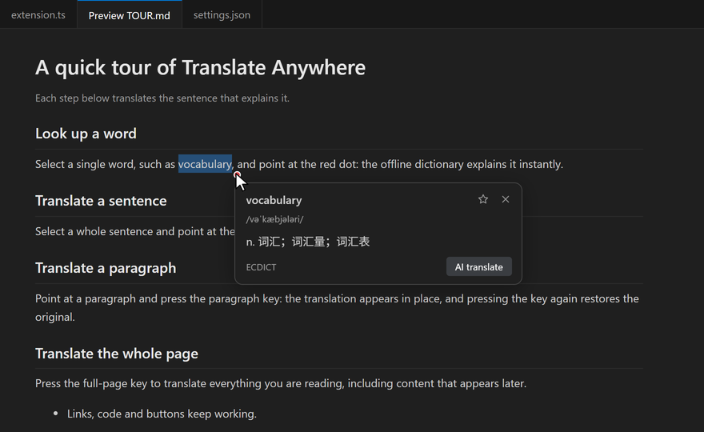
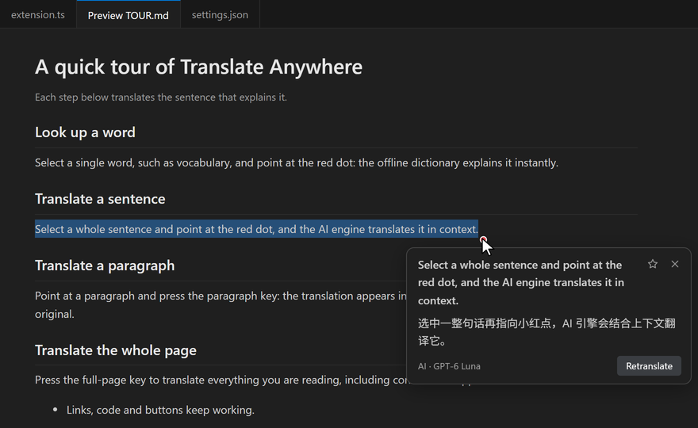
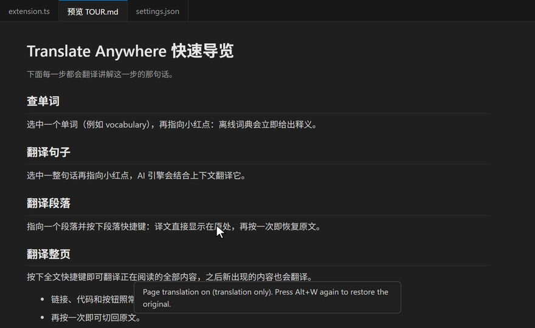
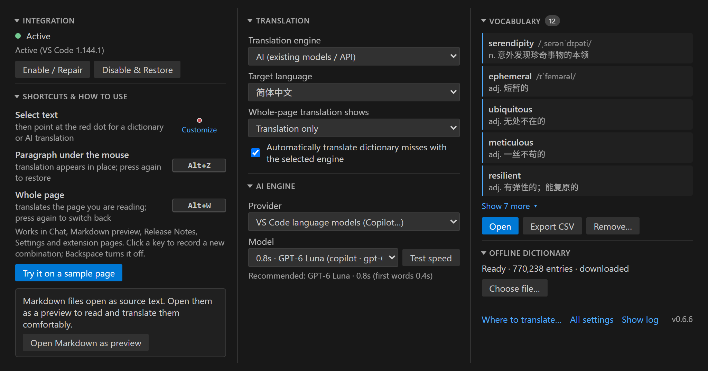

# Translate Anywhere - VS Code Translator for Chat & Markdown

**English** | [简体中文](README.zh-CN.md)

Translate what you read in VS Code: **Chat**, the **Agents window**, **Markdown preview** and other built-in pages, plus the pages and views of **other extensions** (webview panels, sidebar views, custom editors such as a **PDF viewer**). Select text and hover the small red dot, or press a key to translate the paragraph under the mouse or the whole page. You pick the keys in the [sidebar](#settings-sidebar).

- **Words** come from an offline dictionary.
- **Phrases, sentences and pages** go to the engine you choose: an AI model (GitHub Copilot through VS Code, or your own OpenAI, Claude, Gemini, DeepSeek, Qwen… key), a token-free online service, or nothing at all in offline-only mode.
- **Text editors are never touched.** Nothing happens while you write code.

<picture></picture>

> Inspired by the reading experience of the [Immersive Translate](https://chromewebstore.google.com/detail/immersive-translate-ai-we/bpoadfkcbjbfhfodiogcnhhhpibjhbnh) browser extension. Not affiliated with or endorsed by it. The screenshots are rendered from the extension's real UI on demo pages.

## Features

| Feature | How |
| --- | --- |
| **Select & hover** | Select text, then hover the red dot. Words use the offline dictionary; anything else uses the selected engine. Click ☆ to save the entry to your vocabulary book. |
| **Paragraph translation** | Hover a paragraph and press the paragraph key (**Alt+Z** by default). Press again to remove the translation. |
| **Full-page translation** | Press the full-page key (**Alt+W** by default) to translate the Chat conversation, preview or page you are working in; press again to restore. Show the translation only (default) or both languages. |
| **Other extensions too** | Any extension page built on a webview (dashboards, sidebar views, custom editors such as a PDF viewer) works like a built-in page. No per-extension setup. |
| **Your choice of engine** | AI, a token-free online service, or the offline dictionary only. See [Translation engines](#translation-engines). |
| **Markdown as preview** | One click in the sidebar makes `.md` files open as a rendered preview by default; one more click undoes it. |
| **Your languages** | 20 target languages. The interface is in English, Simplified Chinese or German and follows VS Code by default. |

| Dictionary | AI translation |
| --- | --- |
| <picture></picture> | <picture></picture> |
| **Chat** | **Full page** |
| <picture></picture> | <picture></picture> |

<b>Where it works</b>

Turn any surface off under **Where to translate…** in the sidebar footer.

| Surface | Includes |
| --- | --- |
| Markdown preview | The built-in preview. |
| Release Notes | Including the **In this update** contents. |
| Chat | Chat and the separate Agents window: welcome and empty states, responses, agent questions and their options, tool confirmations, banners and input notices. |
| Settings | Settings and Keyboard Shortcuts editors. |
| Extension pages | Extension details pages, and panels, sidebar views and custom editors of any extension that uses a webview. Invisible text layers (like the selectable text over a PDF page) can be looked up but are not translated in place. |
| Welcome | Welcome page and walkthroughs. |
| Workbench UI | Chat Customizations (including Migrations), notifications, dialogs, hover cards, the Workspace Trust page and view messages. |

<b>Shortcuts and full-page translation</b> (both shortcuts are customizable)

| Default | Action |
| --- | --- |
| **Alt+Z** | Translate or restore the paragraph under the mouse. |
| **Alt+W** | Translate or restore the whole page you are working in. |

- **Change them in the sidebar:** click a key under **Shortcuts & how to use** and press a new combination, such as `Ctrl+Shift+Y` or `F8`; Backspace turns a shortcut off. They are handled inside the page, so VS Code's *Keyboard Shortcuts* editor does not list them.
- **Alt+Z** acts on the paragraph under the mouse; full-page translation is triggered by its in-page shortcut (**Alt+W** by default, not a Command Palette command) and acts only on the single pane you most recently clicked or focused, leaving other editor groups, sidebars and webviews untouched. For workbench panes, moving focus to external command UI (the Command Palette, a menu, or a window/header toolbar) retains that last workbench pane for **Alt+W**, while clicking a toolbar or tab inside a different pane switches the target to that pane. Cross-origin webviews (Markdown preview, Release Notes, extension webviews) handle **Alt+W** inside their own frame and cannot be toggled remotely while focus is in workbench command UI—click back inside the webview first. Elsewhere the keys keep their VS Code meaning (`Alt+Z` still toggles word wrap in an editor). On macOS, Option works as Alt.
- They need the AI or online engine; offline-only mode looks up single words.
- **Translation only** replaces text in place, keeping links, inline code, icons and buttons as the page's own working elements. **Bilingual** adds a translated copy under each paragraph.
- Code blocks, inputs and text already in the target language are left alone. Paragraphs are translated as they scroll into view, including content that appears later.

## Settings sidebar

Click the **文A** icon in the Activity Bar. Everything is in one panel:

<picture></picture>

- **Integration**: status, **Enable / Repair** and **Disable & Restore**.
- **Shortcuts & how to use**: record new shortcuts, **Try it on a sample page**, open Markdown as a preview by default. Click the red dot to change its size, color, border and shape, or use your own image.
- **Translation** and **AI engine** (or **Online translation**): engine, target language, full-page mode, provider, model and API key.
- **Vocabulary** and **Offline dictionary**: saved entries with CSV export; dictionary status and a local file option.

Every option except API keys and online-service permissions is an ordinary VS Code setting that syncs with Settings Sync. All settings and commands are listed on the extension's **Features** tab in VS Code.

## Translation engines

Words found in the offline dictionary are always answered locally. Everything else goes to the one engine you choose under **Translation**; a failing engine never falls back to another service.

| Engine | Text goes to | You need | Choose it when |
| --- | --- | --- | --- |
| **AI** *(default)* | A VS Code language model, or an AI provider you add a key for | GitHub Copilot or another VS Code model, or an API key | You want the best quality for sentences and pages. |
| **Online** | Google Translate (experimental) or MyMemory | Nothing; allow the service once | You have no AI model or key. |
| **Offline only** | Nowhere | Nothing | You only look up words, or must not send text anywhere. |

<b>AI: VS Code models and API providers</b>

**VS Code language models** (for example GitHub Copilot) need no key. Pick a model in the sidebar; the list matches the Chat model picker you use. The first translation asks for permission to use the model; if you dismissed that prompt, click **Allow access**. Until you pick a model, each request borrows a small, fast one and labels the result as temporary. **Test speed** times your models and marks those suited to translation as **Recommended**; requests to premium models count toward your Copilot premium-request quota.

**API providers:** [OpenAI](https://platform.openai.com/api-keys), [Anthropic Claude](https://console.anthropic.com/settings/keys), [Google Gemini](https://aistudio.google.com/apikey), [DeepSeek](https://platform.deepseek.com/api_keys), [Alibaba Qwen](https://bailian.console.aliyun.com/?apiKey=1), [Moonshot Kimi](https://platform.moonshot.cn/console/api-keys), [Zhipu GLM](https://open.bigmodel.cn/usercenter/apikeys), [SiliconFlow](https://cloud.siliconflow.cn/account/ak), [OpenRouter](https://openrouter.ai/keys), [Groq](https://console.groq.com/keys), [Mistral AI](https://console.mistral.ai/api-keys), Ollama (local, no key) and **Custom** for any OpenAI-compatible endpoint (LM Studio, vLLM, a company gateway…).

- Each provider has a lightweight default model; **Fetch list** loads the others, or type any model name.
- **Base URL** overrides the endpoint for proxies and regional or self-hosted gateways; **Custom** requires it.
- API keys are kept per provider in VS Code's encrypted [Secret Storage](https://code.visualstudio.com/api/references/vscode-api#SecretStorage), never in `settings.json`, and are not synced.

<b>Online: Google Translate and MyMemory</b>

- **Google Translate (experimental)** uses an unofficial endpoint that may stop working; corporate proxies often block it.
- **MyMemory** is a documented anonymous API with 5,000 characters per day.
- Each service needs a one-time local permission, which you can revoke. If AI mode finds no model, the extension offers to switch to online translation.
- Details, privacy and limits: [docs/ONLINE-TRANSLATION.md](docs/ONLINE-TRANSLATION.md).

<b>Offline dictionaries</b>

- **English → Chinese:** [ECDICT](https://github.com/skywind3000/ECDICT), about 770,000 entries (15 MB).
- **German → Chinese:** derived from [HanDeDict](https://handedict.zydeo.net/), about 130,000 entries (3 MB), downloaded on the first German lookup.
- Dictionaries give Chinese definitions only; other target languages use the selected engine.
- They download once on first use and are verified with SHA-256. Without network access, install the `vscode-translate-anywhere-offline-<version>.vsix` package from [GitHub Releases](https://github.com/MusingZone/vscode-translate-anywhere/releases), or click **Choose file…** in the sidebar to use a local `dictionary.json.gz`. Behind a firewall, set `translateAnywhere.dictionary.downloadUrl` to an internal mirror.

## How the integration works

VS Code gives extensions no API to read selections or draw popups inside Chat, Release Notes, Settings or the built-in Markdown preview. So, **after you consent**, the extension adds a small script to VS Code's own UI files. To enable it, click **Enable…** in the welcome notification or **Enable / Repair** in the sidebar, then reload the window.

- **Files changed:** `workbench.desktop.main.js` and `workbench.html`, the Agents window's `sessions.desktop.main.js` and `sessions.html` (where present), the webview `index.html`, and the matching `checksums` in `product.json`, so VS Code does not report a "corrupt installation".
- **Reversible:** originals are backed up byte for byte, patches are applied atomically, and files changed by anyone else are never overwritten. **Disable & Restore** puts the originals back.
- **Survives updates:** after a VS Code update the integration is reapplied automatically; one reload is enough.
- **Administrator rights only when needed:** if you cannot write to the installation folder, each change asks once for confirmation (UAC, the macOS password dialog or polkit). No service or background elevated process is created.
- **Uninstalling** restores the files at the next full restart. If enabling needed administrator confirmation, click **Disable & Restore** before uninstalling.

<b>Requirements</b>

- Desktop VS Code 1.100 or newer on Windows, macOS or Linux. Not available in VS Code for the Web; in remote windows (SSH, WSL, containers) it runs locally.
- **macOS:** run VS Code from */Applications*; a copy started from *Downloads* or a disk image is read-only.
- **Linux:** Snap and Flatpak installations are read-only; use the `.deb`, `.rpm` or `.tar.gz` build.
- The local bridge uses port `17865`; if several users of one computer run VS Code at once, only the first one gets translations.

## Privacy and security

- **No telemetry.** The extension collects and sends no usage data.
- **Dictionary lookups are local.** The only dictionary network access is the one-time download.
- **AI translation** sends the selected text, or the paragraph or page being translated, only to the provider you chose. **Online translation** sends text only after you allow the service on this computer; MyMemory may retain it, so do not send confidential text or code there.
- Page translation sends visible text with short markers such as `<g1>…</g1>` in place of links and other inline elements. Link targets, code and setting IDs are not sent.
- The injected UI talks to the extension over `127.0.0.1:17865`, protected by a random per-installation token and an origin check.
- **Vocabulary** is saved on this computer and, when VS Code Settings Sync is on (with **Extensions** included), synced through your Settings Sync account to your other computers. It is never sent anywhere else.

Details: [SECURITY.md](SECURITY.md) and [docs/ONLINE-TRANSLATION.md](docs/ONLINE-TRANSLATION.md).

## Troubleshooting

Start with the sidebar: the **Integration** status shows whether the integration is active, and errors appear right in the popup or under the paragraph.

| Symptom | Cause and fix |
| --- | --- |
| No red dot after selecting text | If the status is not **Active**, click **Enable / Repair** and reload the window. If it is active, the page type may be switched off under **Where to translate…**. Code editors are never covered, by design. |
| The popup shows an error | *Not authorized*: click **Allow access** under **AI engine**. Quota, model or network errors: choose another model or switch to the online engine. For API providers, check the key and **Base URL**. **Show log** has the details. |
| A shortcut does nothing | Point at a paragraph for **Alt+Z**, or click inside the pane you want to translate for **Alt+W** (full-page translation uses its in-page shortcut rather than a Command Palette command; code editors are ignored by design, and webviews need focus inside the webview frame). Check the key in the sidebar (empty means off). Offline-only mode translates single words only. |
| Translation is slow | Use a lightweight model: **Test speed** marks the fast ones suited to translation as **Recommended**. |
| Online translation fails | Google is often blocked behind corporate proxies: switch to MyMemory. MyMemory allows 5,000 characters a day; when that is used up, switch to AI. |
| A paragraph shows both languages in "translation only" mode | The engine dropped the paragraph's format markers, so it is shown bilingually to keep its links. Try another model or service. |
| Translation stopped after a VS Code update | The update replaced the integrated files. The extension reapplies them automatically; reload the window once. If it reports *Installation changed outside this extension*, close windows still running an older version of the extension and click **Enable / Repair**. |
| VS Code reports a corrupt installation | Expected once after **Disable & Restore**: fully quit and restart VS Code. |
| Enabling fails on macOS or Linux | That VS Code copy is read-only: on macOS, move it to */Applications*; for Snap or Flatpak, use the `.deb`, `.rpm` or `.tar.gz` build instead. |

Still stuck? [Open an issue](https://github.com/MusingZone/vscode-translate-anywhere/issues) with your VS Code version and the relevant lines from **Show log**.

## Contributing

Issues and pull requests are welcome at [github.com/MusingZone/vscode-translate-anywhere](https://github.com/MusingZone/vscode-translate-anywhere). See [CONTRIBUTING.md](CONTRIBUTING.md) for the development setup, tests (`npm test`, plus headless UI tests in `tools/`) and how to add an interface language. Release history: [CHANGELOG.md](CHANGELOG.md).

If the extension helps you, a rating on the [Marketplace](https://marketplace.visualstudio.com/items?itemName=MusingZone.vscode-translate-anywhere&ssr=false#review-details) helps others find it.

## Credits

- English → Chinese dictionary: [ECDICT](https://github.com/skywind3000/ECDICT) by skywind3000, MIT License.
- German → Chinese dictionary: derived from [HanDeDict](https://handedict.zydeo.net/), CC BY-SA 3.0.
- See [THIRD-PARTY-NOTICES.md](THIRD-PARTY-NOTICES.md).

## License

Extension code: [MIT](LICENSE.txt). The German–Chinese dictionary data (`data/dictionary-de.json.gz`) is licensed under [CC BY-SA 3.0](data/HanDeDict-LICENSE.txt).
