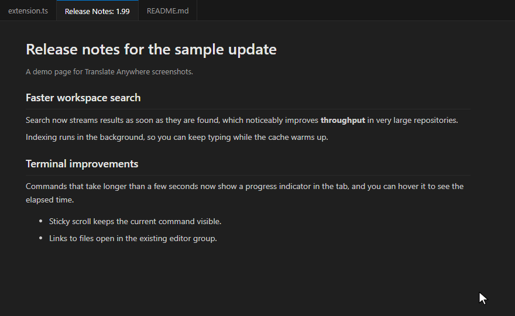
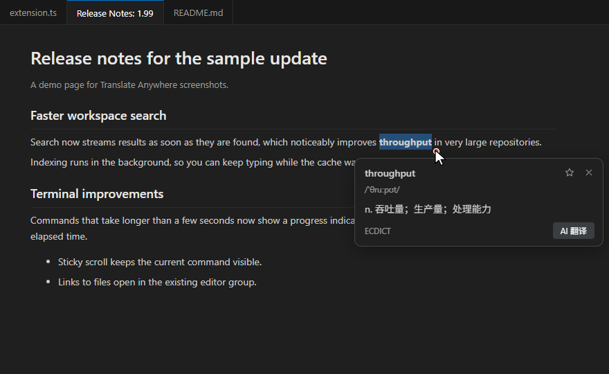
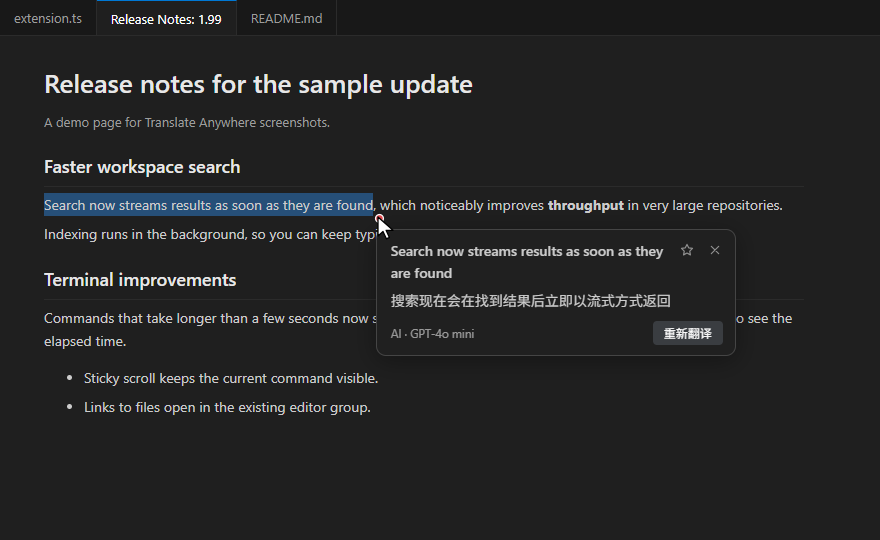
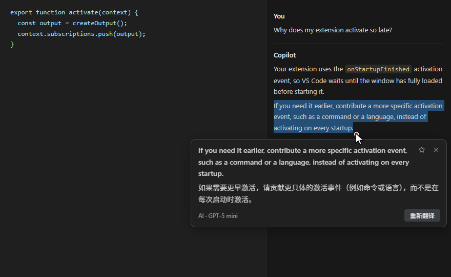
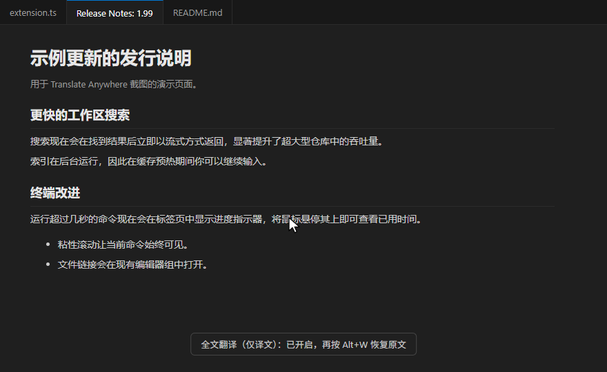
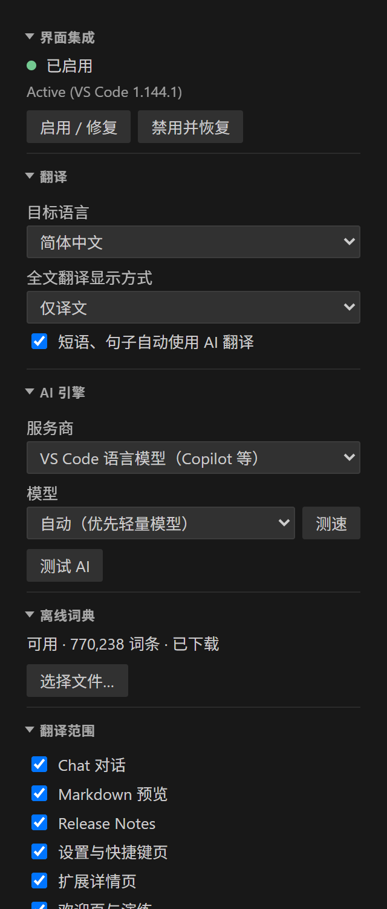

# Translate Anywhere - 划词悬停翻译

[English](README.md) | **简体中文**

在 VS Code 的 **Chat 对话**、**Markdown 预览**、**Release Notes**、**设置页**、**扩展详情页**等内置页面中划选文字，选区旁会出现一个小红点，鼠标悬停即可秒出翻译。

- 单词：查离线词典（英 → 中）。
- 短语、句子、段落：由你选择的 AI 模型翻译。可以通过 VS Code 使用 GitHub Copilot，也可以填写自己的 API Key，使用 OpenAI、Claude、Gemini、DeepSeek、通义千问等服务商。

代码编辑器中**不会**启用翻译，写代码时完全不打扰。

<picture></picture>

> 灵感来自浏览器"沉浸式翻译"类扩展的阅读体验，与它们没有任何关联，也未获其认可。截图由扩展的真实界面在演示页面上渲染生成。

## 功能

| 功能 | 用法 |
| --- | --- |
| **划词悬停翻译** | 划选文字后把鼠标移到红点上。单词查离线词典（英 → 中）；更长的内容或其他目标语言自动使用 AI。 |
| **段落翻译** | 鼠标停在段落上按 **Alt+Z**，再按一次移除译文。 |
| **全文翻译** | 按 **Alt+W** 翻译当前所在的 Chat 对话、预览或页面，再按一次恢复原文。可选"仅译文"（默认）或"原文译文对照"。 |
| **多家 AI 服务商** | VS Code 语言模型（GitHub Copilot，无需 Key）、OpenAI、Anthropic Claude、Google Gemini、DeepSeek、通义千问、Kimi、智谱 GLM、硅基流动、OpenRouter、Groq、Mistral、Ollama，或任何 OpenAI 兼容接口。 |
| **设置侧边栏** | 活动栏中一个面板集中管理：服务商与模型下拉列表、API Key、词典、翻译范围、快捷键、生词本。 |
| **生词本** | 点击弹窗中的 ☆ 收藏单词，可打开、导出 CSV 或删除。 |
| **多语言** | 20 种目标语言；界面语言跟随 VS Code 显示语言。 |

| 词典释义 | AI 翻译 |
| --- | --- |
| <picture></picture> | <picture></picture> |
| **Chat 对话** | **全文翻译（Alt+W）** |
| <picture></picture> | <picture></picture> |

### 支持的页面

每类页面都可以在侧边栏或 `translateAnywhere.surfaces` 中单独关闭：

- Markdown 预览
- Release Notes（更新说明）
- Chat（回复、Agent 向你提问时的提问框、工具确认、输入区提示）
- 设置与键盘快捷方式编辑器
- 扩展详情页（README 与更新日志）
- 欢迎页与演练（Walkthrough）
- 通知、对话框、工作台悬停卡片、工作区信任页与视图提示文字

## 快速开始

1. 安装扩展。
2. 启用界面集成：在欢迎通知中点击 **启用…**，或在 Translate Anywhere 侧边栏点击 **启用 / 修复**。阅读说明后确认。
3. 按提示重新加载窗口。
4. 在 Chat 或 Markdown 预览中划选文字，把鼠标移到红点上。
5. 在侧边栏选择 AI 服务商。默认使用 **VS Code 语言模型**，第一次 AI 翻译时会请求模型使用授权；如果错过了授权提示，在侧边栏点击 **测试 AI** 即可重新触发。

## 设置侧边栏

<picture></picture>

点击活动栏中的 **文A** 图标打开侧边栏，包含以下内容：

- **界面集成**：显示状态，提供"启用 / 修复"和"禁用并恢复"。
- **翻译**：目标语言、全文翻译显示方式、自动 AI。
- **AI 引擎**：
  - 服务商下拉列表；
  - 模型下拉列表（VS Code 模型可选择测速，API 服务商可点击"获取列表"）；
  - API Key 状态及获取 Key 的链接；
  - 可选的 API 地址。
- **离线词典**：状态，以及"下载"、"选择文件"、"恢复默认"。
- **翻译范围**：按页面类型开关。
- **快捷键**：点击输入框后直接按下新的组合键，退格键清空。
- **生词本**：打开、导出、删除。

除 API Key 外，所有选项都是普通的 VS Code 设置，在 **设置 → 扩展 → Translate Anywhere** 中同样可见，也会随设置同步。API Key 只保存在 VS Code 的 Secret Storage 中。

 

## AI 服务商

| 服务商 | 接口 | 默认（轻量）模型 | 获取 Key |
| --- | --- | --- | --- |
| **VS Code 语言模型**（默认） | VS Code Language Model API | 自动：优先 mini / flash / haiku 类模型 | 无需 Key，例如使用你的 GitHub Copilot 订阅 |
| OpenAI | OpenAI | `gpt-4o-mini` | [platform.openai.com](https://platform.openai.com/api-keys) |
| Anthropic Claude | Anthropic Messages | `claude-haiku-4-5` | [console.anthropic.com](https://console.anthropic.com/settings/keys) |
| Google Gemini | OpenAI 兼容 | `gemini-2.5-flash-lite` | [aistudio.google.com](https://aistudio.google.com/apikey) |
| DeepSeek 深度求索 | OpenAI 兼容 | `deepseek-chat` | [platform.deepseek.com](https://platform.deepseek.com/api_keys) |
| 阿里云通义千问（百炼 DashScope） | OpenAI 兼容 | `qwen-flash` | [bailian.console.aliyun.com](https://bailian.console.aliyun.com/?apiKey=1) |
| 月之暗面 Kimi | OpenAI 兼容 | `moonshot-v1-8k` | [platform.moonshot.cn](https://platform.moonshot.cn/console/api-keys) |
| 智谱 GLM | OpenAI 兼容 | `glm-4-flash` | [open.bigmodel.cn](https://open.bigmodel.cn/usercenter/apikeys) |
| 硅基流动 SiliconFlow | OpenAI 兼容 | `Qwen/Qwen2.5-7B-Instruct` | [cloud.siliconflow.cn](https://cloud.siliconflow.cn/account/ak) |
| OpenRouter | OpenAI 兼容 | `openai/gpt-4o-mini` | [openrouter.ai](https://openrouter.ai/keys) |
| Groq | OpenAI 兼容 | `llama-3.1-8b-instant` | [console.groq.com](https://console.groq.com/keys) |
| Mistral AI | OpenAI 兼容 | `mistral-small-latest` | [console.mistral.ai](https://console.mistral.ai/api-keys) |
| Ollama（本地） | OpenAI 兼容 | `qwen2.5:3b` | 无需 Key，运行在 `http://localhost:11434` |
| 自定义 | OpenAI 兼容 | 自行填写 | 任何兼容接口：LM Studio、vLLM、one-api、各类中转/网关…… |

- 在侧边栏中切换模型：点击 **获取列表** 加载服务商的模型列表，也可以直接输入任意模型名。
- **API 地址** 用于覆盖默认接口，适用于代理、国际站（如 `https://dashscope-intl.aliyuncs.com/compatible-mode/v1`）或自建网关。
- 模型名称更新较快，如果默认模型不可用，从列表中换一个即可。
- 默认只推荐轻量模型：翻译需要的是速度，不是推理能力。

**API Key** 使用 VS Code 加密的 [Secret Storage](https://code.visualstudio.com/api/references/vscode-api#SecretStorage) 保存，每个服务商一个，不会写入 `settings.json`，也不会被同步。可在侧边栏点击 **设置 Key**，或运行 **Translate Anywhere: 设置 API Key** 来设置或清除。

## 离线词典

英汉词典使用 [ECDICT](https://github.com/skywind3000/ECDICT)，约 77 万词条，压缩后 15 MB。有三种获取方式：

| 方式 | 说明 |
| --- | --- |
| **自动下载**（默认） | 首次使用时自动下载一次，并用 SHA-256 校验。下载源优先 GitHub Releases，失败时依次尝试 jsDelivr 与 raw.githubusercontent 镜像。下载完成前，所有划词都使用 AI。 |
| **离线安装包** | 从 [GitHub Releases](https://github.com/MusingZone/vscode-translate-anywhere/releases) 下载 `vscode-translate-anywhere-offline-<版本>.vsix`（所有平台通用），在 VS Code 中运行 **扩展：从 VSIX 安装…**。完全不需要联网。 |
| **本地文件** | 在侧边栏点击 **选择文件…**（或设置 `translateAnywhere.dictionary.path`），使用你自己下载或用 `tools/build.py` 生成的 `dictionary.json.gz`。 |

如果网络受限，可将 `translateAnywhere.dictionary.downloadUrl` 设为内网 HTTPS 镜像（文件需相同）；若不希望自动下载，将 `translateAnywhere.dictionary.autoDownload` 设为 `false`。

## 工作原理（请务必阅读）

VS Code 没有给扩展提供在 Chat、Release Notes、设置页或内置 Markdown 预览中读取选区、绘制弹窗的 API。为实现这些功能，本扩展会**向 VS Code 自身的界面文件注入一小段脚本**：

- `out/vs/workbench/workbench.desktop.main.js`
- `out/vs/code/electron-browser/workbench/workbench.html`
- Webview 的 `index.html`
- `product.json` 中对应的 `checksums`

安全措施：

- 在你明确启用前不会修改任何文件（`translateAnywhere.integration.enabled` 默认为 `false`）。
- 原始文件逐字节备份在扩展的全局存储目录中。修改是原子操作，并且拒绝覆盖不是本扩展写入的文件。
- **禁用并恢复 VS Code 原文件** 会还原原始文件。卸载扩展后，VS Code 重启时也会自动还原。
- VS Code 更新替换文件后，集成会自动重新应用（`translateAnywhere.integration.autoRepair`）。
- 如果当前用户对 VS Code 安装目录没有写权限，每次修改都会弹出一次管理员确认：Windows 为 UAC，macOS 为系统密码对话框，Linux 为 polkit（`pkexec`）对话框。不会创建常驻服务或计划任务，扩展保存的文件会归还给当前用户。
- 由于同步更新了校验和，VS Code 不会提示"安装已损坏"。**禁用**后，在完全重启 VS Code 之前，该提示可能会出现一次。

## 设置项

| 设置 | 默认值 | 说明 |
| --- | --- | --- |
| `translateAnywhere.targetLanguage` | `zh-CN` | 目标语言。 |
| `translateAnywhere.uiLanguage` | `auto` | 弹窗、侧边栏与消息语言，`auto` 跟随 VS Code。 |
| `translateAnywhere.surfaces` | 全部开启 | 各类页面的开关。 |
| `translateAnywhere.shortcuts.paragraph` | `Alt+Z` | 段落翻译快捷键，留空表示禁用。 |
| `translateAnywhere.shortcuts.fullPage` | `Alt+W` | 全文翻译快捷键，留空表示禁用。 |
| `translateAnywhere.fullPage.mode` | `translationOnly` | `translationOnly`（仅译文）或 `bilingual`（对照）。 |
| `translateAnywhere.ai.autoTranslate` | `true` | 词典未收录时自动使用 AI。 |
| `translateAnywhere.ai.provider` | `vscode` | AI 服务商（见上表）。 |
| `translateAnywhere.ai.modelId` | （空） | VS Code 语言模型 ID，留空则自动选择并优先轻量模型。 |
| `translateAnywhere.ai.apiModel` | （空） | API 服务商的模型名，留空使用默认模型。 |
| `translateAnywhere.ai.baseUrl` | （空） | API 服务商的接口地址覆盖。 |
| `translateAnywhere.dictionary.autoDownload` | `true` | 首次使用时自动下载词典。 |
| `translateAnywhere.dictionary.path` | （空） | 使用本地词典文件。 |
| `translateAnywhere.dictionary.downloadUrl` | （空） | 优先尝试的额外 HTTPS 下载镜像。 |
| `translateAnywhere.integration.enabled` | `false` | 是否同意上文所述的界面集成。 |
| `translateAnywhere.integration.autoRepair` | `true` | VS Code 更新后自动重新应用。 |

修改后几秒内生效，无需重新加载。

**关于快捷键**：段落与全文翻译快捷键由页面内部处理，因此在侧边栏或上述设置中配置，而不是在"键盘快捷方式"中配置。
- 格式为修饰键用 `+` 连接再加一个按键，例如 `Alt+Z`、`Ctrl+Shift+Y`、`F8`。
- 支持字母、数字、F1–F24、`Space` 和 `` ` ``。
- 鼠标不在支持的页面上时，按键保持 VS Code 原有功能，例如 `Alt+Z` 在编辑器中仍是切换自动换行。

## 命令

所有命令都在命令面板的 **Translate Anywhere:** 分类下，大部分也可以在侧边栏中直接点击。

| 命令 | 用途 |
| --- | --- |
| 启用 / 修复界面集成 · 禁用并恢复 VS Code 原文件 | 应用、修复或移除界面集成。 |
| 选择 AI 服务商 · 选择 AI 模型 · 设置 API Key · 授权 AI 模型 | 配置 AI 引擎。 |
| 下载词典 · 使用本地词典文件… · 使用默认词典 | 管理离线词典。 |
| 打开生词本 · 导出生词本为 CSV · 删除生词本条目 | 管理收藏的单词。 |
| 打开设置 · 显示状态 · 显示日志 | 设置与诊断。 |

## 隐私

- **无遥测**：扩展不收集、不发送任何使用数据。
- **词典查询完全离线**：唯一与词典相关的联网操作是上文所述的一次性下载；离线安装包和本地文件方式完全不联网。
- **AI 翻译**只会把划选的文字（或正在翻译的段落/页面）发送给你选择的服务商：
  - VS Code 语言模型通过 VS Code 的 Language Model API 调用，适用相应提供方（如 GitHub Copilot）的条款。
  - API 服务商使用你的 Key 通过 HTTPS 直接调用，适用该服务商的条款与数据政策。
  - Ollama 等本地接口的数据不离开你的电脑。
  - 如果只想在点击 **AI 翻译** 时才调用 AI，可关闭 `translateAnywhere.ai.autoTranslate`。
- 界面与扩展之间通过只绑定 `127.0.0.1` 的 HTTP 桥通信，使用每次安装随机生成的令牌保护，并校验请求来源。
- 生词本只保存在本机该扩展的 VS Code 全局存储目录中。

## 系统要求与限制

- 支持 **Windows**（x64、ARM64）、**macOS**（Apple Silicon、Intel）和 **Linux**（x64、ARM64、ARMhf），需要桌面版 VS Code Stable 1.100 或更高版本；Insiders 通常也可用。
- **macOS**：Option 键即 Alt，默认快捷键为 Option+Z / Option+W。请从"应用程序"文件夹运行 VS Code；从"下载"或磁盘映像直接运行时，macOS 会从只读副本启动（App Translocation），无法集成。修改应用包会使其代码签名封印失效，但 VS Code 仍可正常启动，**禁用**即可恢复原文件。
- **Linux**：安装在 `/usr/share/code` 的 `.deb`/`.rpm` 版本需要 polkit 认证代理来弹出管理员确认（标准桌面环境均自带）；没有时扩展会提供可复制的终端命令。**Snap** 与 **Flatpak** 安装是只读的，无法集成，请改用 `.deb`、`.rpm` 或 `.tar.gz` 版本。
- 不支持 VS Code 网页版和 Codespaces 浏览器会话。在远程窗口（SSH、WSL、容器）中，扩展作为 UI 扩展运行在本机。
- 需要对 VS Code 安装目录有写入权限；"所有用户"安装需要管理员确认。
- 本地桥使用端口 `17865`。如果同一台电脑上有多个用户同时运行 VS Code，只有第一个用户能使用翻译。
- VS Code 未来版本的界面改动可能导致个别页面暂时失效，需等待扩展更新。
- 离线词典只提供中文释义，其他目标语言始终使用 AI。

## 卸载

卸载后，VS Code 下次完全重启时会自动还原原始文件。如需立即还原，请先在侧边栏点击 **禁用并恢复**（或运行 **禁用并恢复 VS Code 原文件**）再卸载。如果启用时需要管理员确认，请务必先这样做：卸载后的自动还原不具备管理员权限。重新安装或更新 VS Code 也会移除集成。

## 参与贡献

欢迎在 [github.com/MusingZone/vscode-translate-anywhere](https://github.com/MusingZone/vscode-translate-anywhere) 提交 Issue 和 Pull Request。开发环境搭建、如何新增界面语言等请参阅 [CONTRIBUTING.md](CONTRIBUTING.md)（英文）。

- 运行测试：`npm test`（单元测试），`python tools/ui-dom-test.py` 和 `python tools/panel-test.py`（无头 Chrome，需要 `pip install playwright`）。
- 打包：`npm run package`。

## 致谢

- 英汉词典：[ECDICT](https://github.com/skywind3000/ECDICT)（skywind3000，MIT 许可证）。
- 其他随附数据及其许可：详见 [THIRD-PARTY-NOTICES.md](THIRD-PARTY-NOTICES.md)。

## 许可证

扩展代码：[MIT](LICENSE.txt)。词典数据沿用各自的许可，详见 [THIRD-PARTY-NOTICES.md](THIRD-PARTY-NOTICES.md)。
