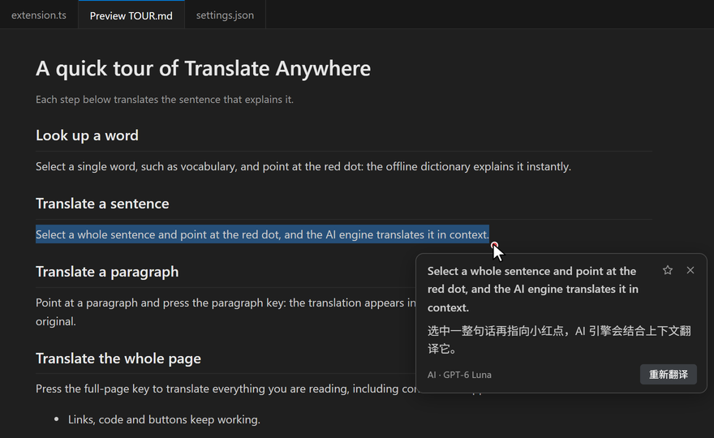

# Translate Anywhere - VS Code 划词翻译与全文翻译插件

[English](README.md) | **简体中文**

在 VS Code 里阅读时随手翻译：支持 **Chat 对话**、独立 **Agents 窗口**、**Markdown 预览**等内置页面，以及**其他扩展**的页面和视图（Webview 面板、侧边栏视图、自定义编辑器，如 **PDF 查看器**）。划选文字后把鼠标移到小红点上即可查看翻译；也可以按快捷键翻译鼠标所在段落或整个页面，按键在[侧边栏](#设置侧边栏)中自行设定。

- **单词**：查离线词典。
- **短语、句子和整页**：交给你选择的引擎——AI 模型（通过 VS Code 使用 GitHub Copilot，或填写自己的 OpenAI、Claude、Gemini、DeepSeek、通义千问等 API Key）、免 Token 的在线翻译，或者在仅离线模式下完全不发送。
- **不会改动代码编辑器**：写代码时完全不打扰。

<picture></picture>

> 灵感来自浏览器扩展[沉浸式翻译](https://chromewebstore.google.com/detail/immersive-translate-ai-we/bpoadfkcbjbfhfodiogcnhhhpibjhbnh)的阅读体验，与其没有任何关联，也未获其认可。截图由扩展的真实界面在演示页面上渲染生成。

## 功能

| 功能 | 用法 |
| --- | --- |
| **划词悬停翻译** | 划选文字后把鼠标移到红点上。单词查离线词典，其余内容使用所选引擎。点击 ☆ 可收藏到生词本。 |
| **段落翻译** | 鼠标停在段落上按段落快捷键（默认 **Alt+Z**），再按一次移除译文。 |
| **全文翻译** | 按全文快捷键（默认 **Alt+W**）翻译当前所在的 Chat 对话、预览或页面，再按一次恢复原文。可选「仅译文」（默认）或「原文译文对照」。 |
| **其他扩展也能翻** | 任何基于 Webview 的扩展页面（仪表盘、侧边栏视图、PDF 查看器等自定义编辑器）都和内置页面一样可用，无需逐个配置。 |
| **翻译引擎任你选** | AI、免 Token 在线翻译，或仅用离线词典。见[翻译引擎](#翻译引擎)。 |
| **Markdown 默认预览** | 在侧边栏一键让 `.md` 文件默认以渲染后的预览打开，再点一次即可撤销。 |
| **多语言** | 20 种目标语言；界面支持英文、简体中文和德文，默认跟随 VS Code。 |

| 词典释义 | AI 翻译 |
| --- | --- |
| <picture></picture> | <picture></picture> |
| **Chat 对话** | **全文翻译** |
| <picture></picture> | <picture></picture> |

<b>支持的页面</b>

每类页面都可以在侧边栏底部的 **翻译范围…** 中单独关闭。

| 页面类型 | 范围 |
| --- | --- |
| Markdown 预览 | 内置的 Markdown 预览。 |
| Release Notes | 包括「In this update」目录。 |
| Chat | Chat 与独立 Agents 窗口：回复、Agent 提问及其选项、工具确认、输入区提示。 |
| 设置 | 设置与键盘快捷方式编辑器。 |
| 扩展页面 | 扩展详情页，以及任何使用 Webview 的扩展的面板、侧边栏视图和自定义编辑器。不可见的文字层（如 PDF 页面上供划选的文字）可以划词查询，但不做原位翻译。 |
| 欢迎页 | 欢迎页与演练（Walkthrough）。 |
| 工作台界面 | 通知、对话框、悬停卡片、工作区信任页与视图提示文字。 |

<b>快捷键与全文翻译</b>（两个快捷键均可自定义）

| 默认快捷键 | 作用 |
| --- | --- |
| **Alt+Z** | 翻译或恢复鼠标所在段落。 |
| **Alt+W** | 翻译或恢复当前所在的整个页面。 |

- **在侧边栏修改**：在 **快捷键与用法** 中点击按键框，按下新的组合键即可，例如 `Ctrl+Shift+Y`、`F8`；按退格键关闭该快捷键。快捷键由页面内部处理，因此不会出现在 VS Code 的「键盘快捷方式」编辑器中。
- 只有鼠标位于支持的页面上时才生效；在其他位置按键保持 VS Code 原有功能（例如 `Alt+Z` 在编辑器中仍是切换自动换行）。macOS 上 Option 键即 Alt。
- 需要 AI 或在线翻译引擎；仅离线模式只能查单词。
- **仅译文** 原地替换文字，链接、行内代码、图标和按钮仍是页面原有的元素，照常可用；**原文译文对照** 在每段下方加一份译文。
- 代码块、输入框以及已经是目标语言的文字不会翻译。段落滚动进入视野时才翻译，之后新出现的内容也会自动翻译。

## 设置侧边栏

点击活动栏中的 **文A** 图标，所有设置都在一个面板里：

<picture></picture>

- **界面集成**：状态、**启用 / 修复**、**禁用并恢复**。
- **快捷键与用法**：录制新快捷键、**在示例页面上试一试**、设置 Markdown 默认以预览打开。点击小红点可调整大小、颜色、边框和形状，也可以换成自己的图片。
- **翻译** 与 **AI 引擎**（或 **在线翻译**）：引擎、目标语言、全文翻译显示方式、服务商、模型和 API Key。
- **生词本** 与 **离线词典**：收藏的条目及 CSV 导出；词典状态与本地文件选项。

除 API Key 和在线服务授权外，所有选项都是普通的 VS Code 设置项，可随设置同步。全部设置项和命令可在 VS Code 扩展页的 **功能**（Features）标签中查看。

## 翻译引擎

离线词典里查得到的单词始终在本地处理。其余内容交给你在 **翻译** 中选定的一个引擎；引擎出错时不会自动切换到其他服务。

| 引擎 | 文本发送到 | 需要 | 适合 |
| --- | --- | --- | --- |
| **AI**（默认） | VS Code 语言模型，或你填写了 Key 的 AI 服务商 | GitHub Copilot 等 VS Code 模型，或一个 API Key | 句子和整页翻译质量最好。 |
| **在线翻译** | Google 翻译（实验性）或 MyMemory | 无，只需授权一次 | 没有 AI 模型也没有 Key。 |
| **仅离线** | 不发送 | 无 | 只查单词，或文本不能外发。 |

<b>AI：VS Code 语言模型与 API 服务商</b>

**VS Code 语言模型**（例如 GitHub Copilot）无需 Key。在侧边栏选择模型，列表与你所用的 Chat 模型选择器一致。第一次翻译时会请求模型使用授权；如果错过了提示，点击 **授权使用** 即可。在你选择模型之前，每次请求临时借用一个小而快的模型，并在结果旁注明。**测速** 会测量你的模型，并把适合翻译的标为 **推荐**；对高级模型的请求会计入 Copilot 高级请求额度。

**API 服务商**：[OpenAI](https://platform.openai.com/api-keys)、[Anthropic Claude](https://console.anthropic.com/settings/keys)、[Google Gemini](https://aistudio.google.com/apikey)、[DeepSeek 深度求索](https://platform.deepseek.com/api_keys)、[阿里云通义千问](https://bailian.console.aliyun.com/?apiKey=1)、[月之暗面 Kimi](https://platform.moonshot.cn/console/api-keys)、[智谱 GLM](https://open.bigmodel.cn/usercenter/apikeys)、[硅基流动](https://cloud.siliconflow.cn/account/ak)、[OpenRouter](https://openrouter.ai/keys)、[Groq](https://console.groq.com/keys)、[Mistral AI](https://console.mistral.ai/api-keys)、Ollama（本地，无需 Key），以及适用于任何 OpenAI 兼容接口的 **自定义**（LM Studio、vLLM、各类中转/网关……）。

- 每个服务商都有一个轻量的默认模型；点击 **获取列表** 加载其他模型，也可以直接输入任意模型名。
- **API 地址** 用于代理、国际站或自建网关；「自定义」必须填写。
- API Key 按服务商分别保存在 VS Code 加密的 [Secret Storage](https://code.visualstudio.com/api/references/vscode-api#SecretStorage) 中，不写入 `settings.json`，也不随设置同步。

<b>在线翻译：Google 翻译与 MyMemory</b>

- **Google 翻译（实验性）** 使用非正式接口，随时可能失效；公司代理网络下常被拦截。
- **MyMemory** 是正式的匿名接口，每天 5,000 字符。
- 每个服务首次使用时需在本机授权一次，可随时撤销。AI 模式下找不到模型时，扩展会主动询问是否改用在线翻译。
- 详情、隐私与限制：[docs/ONLINE-TRANSLATION.md](docs/ONLINE-TRANSLATION.md)（英文）。

<b>离线词典</b>

- **英译中**：[ECDICT](https://github.com/skywind3000/ECDICT)，约 77 万词条（15 MB）。
- **德译中**：基于 [HanDeDict](https://handedict.zydeo.net/) 整理，约 13 万词条（3 MB），首次查德语单词时下载。
- 词典只提供中文释义；其他目标语言使用所选引擎。
- 首次使用时自动下载一次，并用 SHA-256 校验。无法联网时，可从 [GitHub Releases](https://github.com/MusingZone/vscode-translate-anywhere/releases) 安装 `vscode-translate-anywhere-offline-<版本>.vsix`，或在侧边栏点击 **选择文件…** 使用本地 `dictionary.json.gz`。网络受限时，可把 `translateAnywhere.dictionary.downloadUrl` 设为内网镜像。

## 界面集成的工作原理

VS Code 没有给扩展提供在 Chat、Release Notes、设置页或内置 Markdown 预览中读取选区、绘制弹窗的 API。因此**在你同意后**，扩展会向 VS Code 自身的界面文件加入一小段脚本。启用方法：在欢迎通知中点击 **启用…**，或在侧边栏点击 **启用 / 修复**，然后重新加载窗口。

- **修改的文件**：`workbench.desktop.main.js` 和 `workbench.html`、Agents 窗口的 `sessions.desktop.main.js` 和 `sessions.html`（如有）、Webview 的 `index.html`，以及 `product.json` 中对应的 `checksums`，因此 VS Code 不会提示「安装已损坏」。
- **可还原**：原始文件逐字节备份，修改以原子方式进行，绝不覆盖被他人改动过的文件。**禁用并恢复** 即可还原原始文件。
- **更新后自动恢复**：VS Code 更新后自动重新应用集成，重新加载一次窗口即可。
- **仅在必要时请求管理员权限**：如果你对安装目录没有写权限，每次修改会请求一次确认（UAC、macOS 密码对话框或 polkit）。不会创建服务或常驻的提权进程。
- **卸载**后，VS Code 下次完全重启时会还原原始文件。如果启用时需要管理员确认，请先点击 **禁用并恢复** 再卸载。

<b>系统要求</b>

- 桌面版 VS Code 1.100 或更高版本，支持 Windows、macOS 和 Linux。不支持 VS Code 网页版；在远程窗口（SSH、WSL、容器）中运行在本机。
- **macOS**：请从「应用程序」文件夹运行 VS Code；从「下载」或磁盘映像直接运行的副本是只读的。
- **Linux**：Snap 与 Flatpak 安装是只读的，请改用 `.deb`、`.rpm` 或 `.tar.gz` 版本。
- 本地桥使用端口 `17865`；同一台电脑上有多个用户同时运行 VS Code 时，只有第一个用户能使用翻译。

## 隐私与安全

- **无遥测**：扩展不收集、不发送任何使用数据。
- **查词在本地完成**：唯一与词典相关的联网操作是一次性下载。
- **AI 翻译**只把划选的文字（或正在翻译的段落、页面）发送给你选择的服务商。**在线翻译**只有在你于本机授权后才会发送文本；MyMemory 可能保留文本，请勿用它翻译机密文本或代码。
- 整页翻译发送的是可见文字，并在链接等行内元素的位置插入 `<g1>…</g1>` 这样的简短标记；链接地址、代码和设置项 ID 不会发送。
- 注入的界面通过 `127.0.0.1:17865` 与扩展通信，使用每次安装随机生成的令牌保护，并校验请求来源。
- **生词本**保存在本机；开启 VS Code 设置同步（且勾选“扩展”）后，会通过你的设置同步账号同步到其他电脑，不会发往其他任何地方。

详见 [SECURITY.md](SECURITY.md) 与 [docs/ONLINE-TRANSLATION.md](docs/ONLINE-TRANSLATION.md)（英文）。

## 常见问题

先看侧边栏：**界面集成** 的状态说明集成是否已生效；出错时，原因会直接显示在弹窗或段落下方。

| 现象 | 原因与处理 |
| --- | --- |
| 划词后不出现红点 | 状态不是 **已启用** 时，点击 **启用 / 修复** 并重新加载窗口。已启用时，可能是 **翻译范围…** 中关闭了这类页面。代码编辑器按设计始终不翻译。 |
| 弹窗显示错误 | 「尚未授权」：在 **AI 引擎** 下点击 **授权使用**。额度、模型或网络错误：换一个模型，或改用在线翻译。使用 API 服务商时，检查 Key 和 **API 地址**。**查看日志** 中有详细信息。 |
| 按快捷键没反应 | 快捷键作用于鼠标所在的页面，请先把鼠标移到页面或 Chat 回复上。在侧边栏检查按键（为空表示已关闭）。仅离线模式只能查单词。 |
| 翻译很慢 | 改用轻量模型：**测速** 会把适合翻译的快速模型标为 **推荐**。 |
| 在线翻译失败 | 公司代理网络常拦截 Google：改用 MyMemory。MyMemory 每天 5,000 字符，用完后请改用 AI。 |
| 「仅译文」模式下个别段落显示原文加译文 | 翻译引擎丢失了该段的格式标记，为保住原文链接而改为对照显示。可换一个模型或服务再试。 |
| VS Code 更新后翻译失效 | 更新替换了集成过的文件。扩展会自动重新应用，重新加载一次窗口即可。如果提示「Installation changed outside this extension」，关闭仍在运行旧版扩展的窗口，再点击 **启用 / 修复**。 |
| VS Code 提示「安装已损坏」 | **禁用并恢复** 后会出现一次，属正常现象：完全退出并重启 VS Code 即可。 |
| macOS 或 Linux 上无法启用 | 该 VS Code 副本是只读的：macOS 请移到「应用程序」文件夹；Snap 或 Flatpak 请改用 `.deb`、`.rpm` 或 `.tar.gz` 版本。 |

仍未解决？请[提交 Issue](https://github.com/MusingZone/vscode-translate-anywhere/issues)，附上 VS Code 版本和 **查看日志** 中的相关内容。

## 参与贡献

欢迎在 [github.com/MusingZone/vscode-translate-anywhere](https://github.com/MusingZone/vscode-translate-anywhere) 提交 Issue 和 Pull Request。开发环境、测试（`npm test` 及 `tools/` 中的无头界面测试）和新增界面语言的方法请参阅 [CONTRIBUTING.md](CONTRIBUTING.md)（英文）。版本历史见 [CHANGELOG.md](CHANGELOG.md)。

如果这个扩展对你有帮助，欢迎在 [Marketplace](https://marketplace.visualstudio.com/items?itemName=MusingZone.vscode-translate-anywhere&ssr=false#review-details) 评分，让更多人找到它。

## 致谢

- 英汉词典：[ECDICT](https://github.com/skywind3000/ECDICT)（skywind3000，MIT 许可证）。
- 德汉词典：基于 [HanDeDict](https://handedict.zydeo.net/)（CC BY-SA 3.0）。
- 详见 [THIRD-PARTY-NOTICES.md](THIRD-PARTY-NOTICES.md)。

## 许可证

扩展代码：[MIT](LICENSE.txt)。德汉词典数据（`data/dictionary-de.json.gz`）采用 [CC BY-SA 3.0](data/HanDeDict-LICENSE.txt) 许可。
