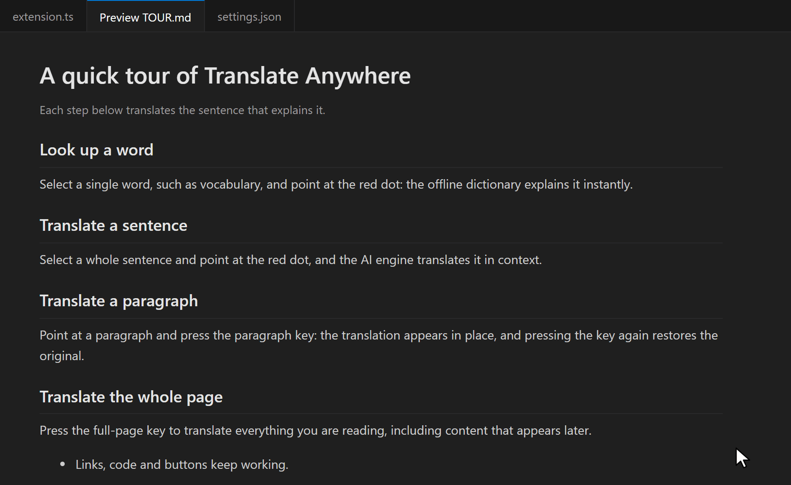
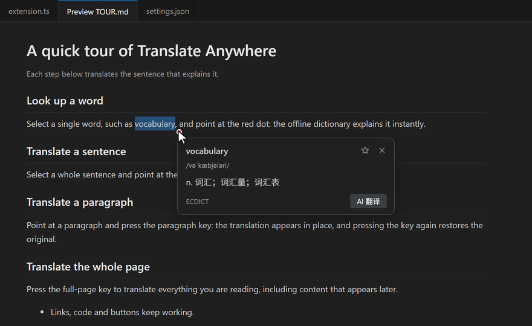
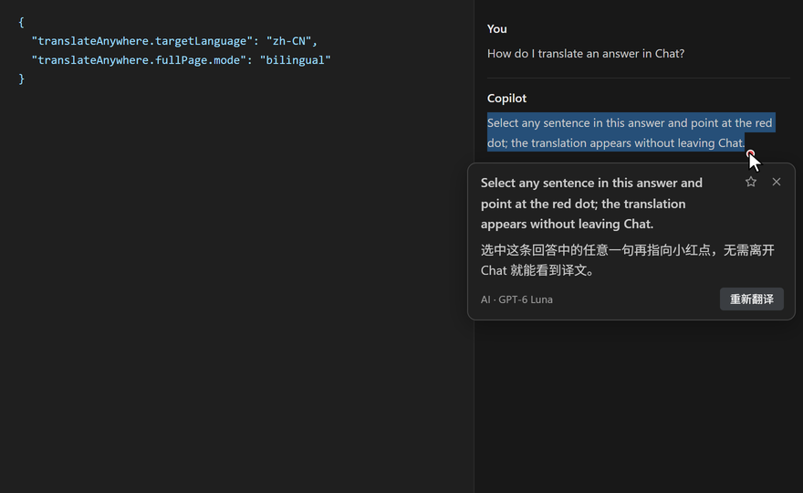
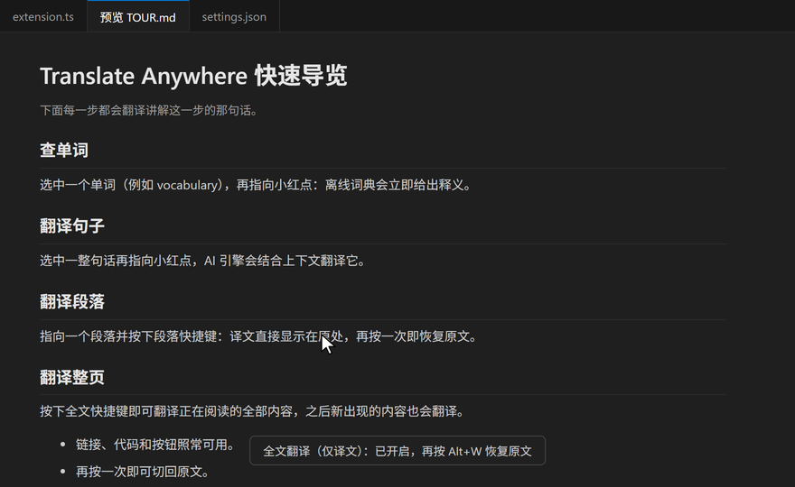
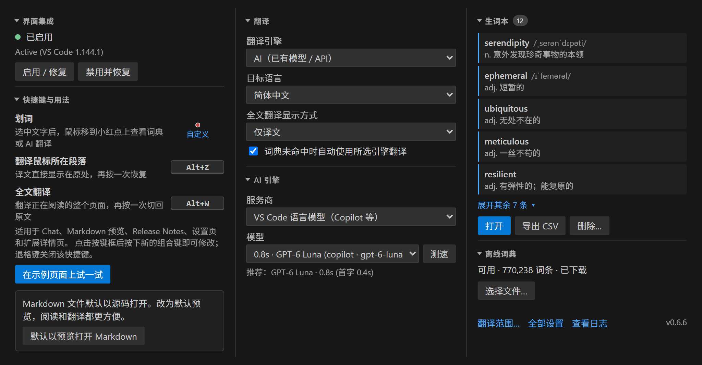

# Translate Anywhere - VS Code 划词翻译与全文翻译插件

[English](README.md) | **简体中文**

在 VS Code 里阅读时随手翻译：支持 **Chat 对话**、独立 **Agents 窗口**、**Markdown 预览**、**Release Notes**、**设置页**、扩展详情页等内置页面，以及**其他扩展**的页面和视图（Webview 面板、侧边栏视图、自定义编辑器，如 PDF 查看器）。划选文字后把鼠标移到小红点上即可查看翻译；按 **Alt+Z** 翻译鼠标所在段落，按 **Alt+W** 翻译整页。

- **单词**：查离线词典。
- **短语、句子和整页**：交给你选择的引擎——AI 模型（通过 VS Code 使用 GitHub Copilot，或填写自己的 OpenAI、Claude、Gemini、DeepSeek、通义千问等 API Key）、免 Token 的在线翻译，或者在仅离线模式下完全不发送。
- **不会改动代码编辑器**：写代码时完全不打扰。

<picture></picture>

> 灵感来自浏览器扩展[沉浸式翻译](https://chromewebstore.google.com/detail/immersive-translate-ai-we/bpoadfkcbjbfhfodiogcnhhhpibjhbnh)的阅读体验，与其没有任何关联，也未获其认可。截图由扩展的真实界面在演示页面上渲染生成。

## 快速开始

1. 安装扩展。
2. 在欢迎通知中点击 **启用…**，或在 Translate Anywhere 侧边栏（活动栏中的 **文A** 图标）点击 **启用 / 修复**。阅读说明后确认：扩展会向 VS Code 自身的界面文件加入一小段可还原的脚本（[详情](#界面集成的工作原理)）。
3. 按提示重新加载窗口。
4. 点击侧边栏中的 **在示例页面上试一试**，或在 Chat、Markdown 预览中划选文字，把鼠标移到红点上。
5. 选择[翻译引擎](#翻译引擎)。默认使用 **VS Code 语言模型**（AI）：请在侧边栏选择模型。第一次 AI 翻译时会请求模型使用授权；如果错过了授权提示，在侧边栏点击 **授权使用** 即可。

## 功能

| 功能 | 用法 |
| --- | --- |
| **划词悬停翻译** | 划选文字后把鼠标移到红点上。单词查离线词典，其余内容使用所选引擎。点击 ☆ 可收藏到生词本。 |
| **段落翻译** | 鼠标停在段落上按 **Alt+Z**，再按一次移除译文。 |
| **全文翻译** | 按 **Alt+W** 翻译当前所在的 Chat 对话、预览或页面，再按一次恢复原文。可选「仅译文」（默认）或「原文译文对照」。 |
| **其他扩展也能翻** | 任何基于 Webview 的扩展页面（仪表盘、更新中心、侧边栏视图、PDF 查看器等自定义编辑器）都和内置页面一样支持划词、**Alt+Z** 和 **Alt+W**，无需逐个配置。代码、输入框和按钮不受影响。 |
| **三种翻译引擎** | AI、免 Token 在线翻译（Google 翻译或 MyMemory）、仅离线词典。 |
| **设置侧边栏** | 在一个面板中管理引擎、模型、API Key、快捷键、小圆点样式、生词本和词典。 |
| **Markdown 默认预览** | 在侧边栏一键让 `.md` 文件默认以渲染后的预览打开；点 **恢复为源码打开** 即可撤销。 |
| **多语言** | 20 种目标语言；界面支持英文、简体中文和德文，默认跟随 VS Code。 |

| 词典释义 | AI 翻译 |
| --- | --- |
| <picture></picture> | <picture></picture> |
| **Chat 对话** | **全文翻译（Alt+W）** |
| <picture></picture> | <picture></picture> |

## 支持的页面

每类页面都可以在侧边栏底部的 **翻译范围…** 中单独关闭（`translateAnywhere.surfaces`）：

| 页面类型 | 范围 |
| --- | --- |
| Markdown 预览 | 内置的 Markdown 预览。 |
| Release Notes | 包括「In this update」目录。 |
| Chat | Chat 与独立 Agents 窗口：回复、Agent 提问及可划选的选项与回答摘要、工具确认、输入区提示。 |
| 设置 | 设置与键盘快捷方式编辑器。 |
| 扩展页面 | 扩展详情页（README 与更新日志），以及任何使用 Webview 的扩展的页面和视图，如面板、侧边栏视图和自定义编辑器（例如 PDF 查看器）。页面中不可见的文字层（如 PDF 页面上供划选的文字）可以划词查询，但不做原位翻译。 |
| 欢迎页 | 欢迎页与演练（Walkthrough）。 |
| 工作台界面 | 通知、对话框、悬停卡片、工作区信任页与视图提示文字。 |

## 快捷键与全文翻译

| 快捷键 | 作用 |
| --- | --- |
| **Alt+Z** | 翻译或恢复鼠标所在段落。 |
| **Alt+W** | 翻译或恢复当前所在的整个页面。 |

- macOS 上 Option 键即 Alt（Option+Z、Option+W）。
- 只有鼠标位于支持的页面上时快捷键才生效；在其他位置按键保持 VS Code 原有功能，例如 `Alt+Z` 在编辑器中仍是切换自动换行。
- 快捷键由页面内部处理，因此请在侧边栏（点击按键框后按下新组合键，退格键关闭）或设置中修改，而不是在「键盘快捷方式」中修改。格式为用 `+` 连接的修饰键加一个字母、数字、F1–F24、`Space` 或 `` ` ``，例如 `Ctrl+Shift+Y`、`F8`。
- 段落与全文翻译需要 AI 或在线翻译引擎；仅离线模式只能查单词。

全文翻译不会破坏页面：

- **仅译文**：原地替换文字。链接、可点击的设置项、行内代码、按键、图标、复选框和按钮都是页面原有的元素，外观和行为与翻译前一致。
- **原文译文对照**：在每段下方加一份译文。译文中的链接可以点击，其他控件会转发给原文中的对应控件。
- 代码块、编辑器、输入框以及已经是目标语言的文字不会翻译。段落滚动进入视野时才翻译，之后新出现的内容也会自动翻译。
- 如果翻译引擎丢失了某段的格式标记，该段会改为对照显示，确保原文链接不丢失。

## 翻译引擎

在侧边栏 **翻译** 中选择引擎（`translateAnywhere.translation.engine`）。词典命中始终在本地处理；引擎出错时不会自动切换到其他服务。

### AI（默认）

| 服务商 | 接口 | 默认模型 | 获取 Key |
| --- | --- | --- | --- |
| **VS Code 语言模型**（默认） | VS Code Language Model API | 无，由你选择 | 无需 Key，例如使用你的 GitHub Copilot 订阅 |
| OpenAI | OpenAI | `gpt-4o-mini` | [platform.openai.com](https://platform.openai.com/api-keys) |
| Anthropic Claude | Anthropic Messages | `claude-haiku-4-5` | [console.anthropic.com](https://console.anthropic.com/settings/keys) |
| Google Gemini | OpenAI 兼容 | `gemini-2.5-flash-lite` | [aistudio.google.com](https://aistudio.google.com/apikey) |
| DeepSeek 深度求索 | OpenAI 兼容 | `deepseek-chat` | [platform.deepseek.com](https://platform.deepseek.com/api_keys) |
| 阿里云通义千问（百炼 DashScope） | OpenAI 兼容 | `qwen-flash` | [bailian.console.aliyun.com](https://bailian.console.aliyun.com/?apiKey=1) |
| 月之暗面 Kimi | OpenAI 兼容 | `moonshot-v1-8k` | [platform.moonshot.cn](https://platform.moonshot.cn/console/api-keys) |
| 智谱 GLM | OpenAI 兼容 | `glm-4-flash` | [open.bigmodel.cn](https://open.bigmodel.cn/usercenter/apikeys) |
| 硅基流动 SiliconFlow | OpenAI 兼容 | `Qwen/Qwen2.5-7B-Instruct` | [cloud.siliconflow.cn](https://cloud.siliconflow.cn/account/ak) |
| OpenRouter | OpenAI 兼容 | `openai/gpt-4o-mini` | [openrouter.ai](https://openrouter.ai/keys) |
| Groq | OpenAI 兼容 | `llama-3.1-8b-instant` | [console.groq.com](https://console.groq.com/keys) |
| Mistral AI | OpenAI 兼容 | `mistral-small-latest` | [console.mistral.ai](https://console.mistral.ai/api-keys) |
| Ollama（本地） | OpenAI 兼容 | `qwen2.5:3b` | 无需 Key，运行在 `http://localhost:11434` |
| 自定义 | OpenAI 兼容 | 自行填写 | 任何兼容接口：LM Studio、vLLM、one-api、各类中转/网关…… |

**VS Code 语言模型**

- 列表显示你当前所用 Chat 模型选择器中可选的模型（包括 Copilot CLI 会话和 Agents 窗口），保持 VS Code 原有顺序。不提供「自动」选项。
- 扩展不会替你选定模型。在你选择之前，每次请求会临时借用一个可见的小而快的模型（luna、haiku、flash、mini 等），并在结果旁注明是临时模型，不保存任何选择。你在另一台电脑上选好的模型会经设置同步带过来。
- 已保存、之后才隐藏的模型仍保持选中并标为 **已隐藏**；已不可用的模型标为 **不可用**，需另选一个。
- **测速** 会测量每个可见且已授权的模型（预热一次、计时三次、显示中位数），再由其中最快的轻量模型挑出适合翻译的模型，标为 **推荐**。测速只在你点击时运行；对高级模型的请求会计入 Copilot 高级请求额度。

**API 服务商**

- 点击 **获取列表** 加载服务商的模型，也可以直接输入任意模型名。默认只推荐轻量模型：翻译看重速度，而不是推理能力。
- **API 地址** 用于覆盖默认接口，适用于代理、国际站（如 `https://dashscope-intl.aliyuncs.com/compatible-mode/v1`）或自建网关；「自定义」服务商必须填写。
- API Key 按服务商分别保存在 VS Code 加密的 [Secret Storage](https://code.visualstudio.com/api/references/vscode-api#SecretStorage) 中，不写入 `settings.json`，也不随设置同步。可在侧边栏点击 **设置 Key**，或运行 **Translate Anywhere: 设置 API Key**。

### 在线翻译（无需 API Key）

- **Google 翻译（实验性）**：非正式接口，并非正式的 Cloud API，随时可能失效或被拦截；公司代理网络下常被拒绝。
- **MyMemory**：正式的免密匿名接口，每天 5,000 字符。
- 每个服务首次使用时需在本机授权一次，可随时撤销。源语言默认自动检测，也可手动指定。
- AI 模式下找不到可用的 Copilot / VS Code 模型时，会主动询问是否改用在线翻译、配置 AI API 或仅用离线词典。
- 调研、试用步骤、隐私与限制：[docs/ONLINE-TRANSLATION.md](docs/ONLINE-TRANSLATION.md)。

### 离线词典

- 英译中：[ECDICT](https://github.com/skywind3000/ECDICT)，约 77 万词条（压缩后 15 MB）。
- 德译中：基于 [HanDeDict](https://handedict.zydeo.net/) 整理，约 13 万词条（3 MB），首次查德语单词时下载。可用 `translateAnywhere.dictionary.german` 关闭。
- 词典只提供中文释义；其他目标语言使用所选引擎。

获取词典的方式：

| 方式 | 说明 |
| --- | --- |
| **自动下载**（默认） | 首次使用时下载一次，优先 GitHub Releases，失败时改用 jsDelivr 与 raw.githubusercontent 镜像，并用 SHA-256 校验。 |
| **离线安装包** | 从 [GitHub Releases](https://github.com/MusingZone/vscode-translate-anywhere/releases) 下载 `vscode-translate-anywhere-offline-<版本>.vsix`（所有平台通用），运行 **扩展：从 VSIX 安装…**。完全不需要联网。 |
| **本地文件** | 在侧边栏点击 **选择文件…**（或设置 `translateAnywhere.dictionary.path`），使用你自己下载或用 `tools/build.py` 生成的 `dictionary.json.gz`。 |

网络受限时，可把 `translateAnywhere.dictionary.downloadUrl` 设为内网 HTTPS 镜像（文件需相同）；把 `translateAnywhere.dictionary.autoDownload` 设为 `false` 则不再自动下载英汉词典。

## 设置侧边栏

<picture></picture>

点击活动栏中的 **文A** 图标：

- **界面集成**：状态、**启用 / 修复**、**禁用并恢复**。
- **快捷键与用法**：修改快捷键、**在示例页面上试一试**、设置 Markdown 默认以预览打开。点击小圆点可调整大小、颜色、边框、不透明度和形状，也可以换成自己的图片（PNG、JPG、GIF、WebP、SVG）。
- **翻译**：引擎、目标语言、全文翻译显示方式、词典未命中时自动翻译。
- **在线翻译** 或 **AI 引擎**（随所选引擎显示）：服务与授权；或服务商、模型、**测速** / **获取列表**、API Key 和 API 地址。
- **生词本**：最近收藏的条目；打开、导出 CSV、删除。
- **离线词典**：状态、**下载**、**选择文件…**、**恢复默认**。
- 底部：**翻译范围…**、全部设置、查看日志。

除 API Key 和在线服务授权外，所有选项都是 **设置 → 扩展 → Translate Anywhere** 下的普通设置项，可随设置同步。

 

## 设置项

修改后几秒内生效，无需重新加载。

| 设置 | 默认值 | 说明 |
| --- | --- | --- |
| `translateAnywhere.translation.engine` | `ai` | `ai`、`online` 或 `offline`；任何模式下词典命中都在本地处理。 |
| `translateAnywhere.targetLanguage` | `zh-CN` | 目标语言。 |
| `translateAnywhere.uiLanguage` | `auto` | 界面语言：`auto`（跟随 VS Code）、`en`、`zh-CN` 或 `de`。 |
| `translateAnywhere.surfaces` | 全部开启 | 各类[页面](#支持的页面)的开关。 |
| `translateAnywhere.shortcuts.paragraph` | `Alt+Z` | 段落翻译快捷键，留空表示禁用。 |
| `translateAnywhere.shortcuts.fullPage` | `Alt+W` | 全文翻译快捷键，留空表示禁用。 |
| `translateAnywhere.fullPage.mode` | `translationOnly` | `translationOnly`（仅译文）或 `bilingual`（对照）。 |
| `translateAnywhere.dot.size` / `color` / `borderWidth` / `borderColor` / `opacity` / `shape` | `7` / `#e5484d` / `1` / `#ffffff` / `0.85` / `circle` | 划词小圆点的样式。更方便的方式：在侧边栏点击小圆点。 |
| `translateAnywhere.ai.autoTranslate` | `true` | 词典未收录时自动使用所选引擎；关闭后需点击弹窗中的翻译按钮。仅离线模式忽略此项。 |
| `translateAnywhere.ai.provider` | `vscode` | AI 服务商（见 [AI](#ai默认)）。 |
| `translateAnywhere.ai.modelId` | （空） | VS Code 语言模型。在你选择之前保持为空，每次请求临时借用轻量模型。 |
| `translateAnywhere.ai.apiModel` | （空） | API 服务商的模型名，留空使用默认模型。 |
| `translateAnywhere.ai.baseUrl` | （空） | API 服务商的接口地址覆盖；「自定义」必须填写。 |
| `translateAnywhere.online.provider` | `google` | `google`（实验性）或 `mymemory`，需分别在本机授权。 |
| `translateAnywhere.online.sourceLanguage` | `auto` | 自动检测或指定源语言。 |
| `translateAnywhere.dictionary.autoDownload` | `true` | 首次使用时自动下载英汉词典。 |
| `translateAnywhere.dictionary.path` | （空） | 使用本地词典文件。 |
| `translateAnywhere.dictionary.downloadUrl` | （空） | 优先尝试的额外 HTTPS 下载镜像。 |
| `translateAnywhere.dictionary.german` | `true` | 用德汉词典查德语单词（首次使用时下载）。 |
| `translateAnywhere.integration.enabled` | `false` | 是否同意[界面集成](#界面集成的工作原理)。 |
| `translateAnywhere.integration.autoRepair` | `true` | VS Code 更新后自动重新应用集成。 |

## 命令

所有命令都在命令面板的 **Translate Anywhere:** 分类下，大部分也可以在侧边栏中直接点击。

| 命令 | 用途 |
| --- | --- |
| 启用 / 修复界面集成 · 禁用并恢复 VS Code 原文件 | 应用、修复或移除界面集成。 |
| 选择 AI 服务商 · 选择 AI 模型 · 设置 API Key · 授权 AI 模型 | 配置 AI 引擎。 |
| 允许在线翻译服务 · 撤销在线翻译授权 | 管理所选在线服务的本机授权。 |
| 下载词典 · 使用本地词典文件… · 使用默认词典 | 管理离线词典。 |
| 在示例页面上试用 · 自定义划词小圆点 · 选择翻译范围 · 默认以预览方式打开 Markdown 文件 · 默认以文本方式打开 Markdown 文件 | 上手与阅读体验。 |
| 打开生词本 · 导出生词本为 CSV · 删除生词本条目 | 管理收藏的条目。 |
| 打开侧边栏 · 打开设置 · 显示状态 · 显示日志 | 设置与诊断。 |

## 隐私与安全

- **无遥测**：扩展不收集、不发送任何使用数据。
- **查词在本地完成**：唯一与词典相关的联网操作是一次性下载；离线安装包和本地文件方式完全不联网。
- **AI 翻译**只把划选的文字（或正在翻译的段落、页面）发送给你选择的服务商：通过 VS Code 的 Language Model API（例如 GitHub Copilot，适用其条款）、使用你的 Key 经 HTTPS 直接调用，或发送到 Ollama 等本地接口。
- **在线翻译**只有在你于本机授权后，才会把文本直接发送给所选服务。MyMemory 可能保留文本并与翻译合作方共享；查询参数可能出现在服务端或代理日志中。请勿发送机密文本或代码；撤销授权无法收回已发送的文本。
- **仅离线词典**模式从不调用 AI 或在线翻译。
- 段落与全文翻译发送的是可见文字，并在链接等行内元素的位置插入 `<g1>…</g1>` 这样的简短标记；链接地址、代码和设置项 ID 不会发送。
- 注入的界面通过 `127.0.0.1:17865` 上的本地桥与扩展通信，使用每次安装随机生成的令牌保护，并校验请求来源。多人共用的电脑建议使用按用户安装的 VS Code。
- 生词本只保存在本机该扩展的全局存储目录中。

详见 [SECURITY.md](SECURITY.md) 与 [docs/ONLINE-TRANSLATION.md](docs/ONLINE-TRANSLATION.md)（英文）。

## 界面集成的工作原理

VS Code 没有给扩展提供在 Chat、Release Notes、设置页或内置 Markdown 预览中读取选区、绘制弹窗的 API。因此在你同意后，本扩展会**向 VS Code 自身的界面文件注入一小段脚本**：

- `out/vs/workbench/workbench.desktop.main.js`
- `out/vs/code/electron-browser/workbench/workbench.html`
- Agents 窗口的 `out/vs/sessions/sessions.desktop.main.js` 和 `out/vs/sessions/electron-browser/sessions.html`（仅限带有 Agents 窗口的 VS Code 版本）
- Webview 的 `index.html`
- `product.json` 中对应的 `checksums`

安全措施：

- 在你启用集成之前不会修改任何文件（`translateAnywhere.integration.enabled` 默认为 `false`）。
- 原始文件逐字节备份在扩展的全局存储目录中。修改以原子方式进行，绝不覆盖被他人改动过的文件。
- **禁用并恢复 VS Code 原文件** 会还原原始文件。VS Code 更新替换文件后，集成会自动重新应用（`translateAnywhere.integration.autoRepair`），重新加载一次窗口即可。
- 如果当前用户对安装目录没有写权限，每次修改都会弹出一次管理员确认（Windows 为 UAC，macOS 为系统密码对话框，Linux 为 polkit `pkexec`）。不会创建服务、计划任务或常驻的提权进程。
- 由于同步更新了校验和，VS Code 不会提示「安装已损坏」。禁用后，在完全重启 VS Code 之前，该提示可能出现一次。

## 常见问题

| 现象 | 处理方法 |
| --- | --- |
| 划词后不出现红点 | 查看侧边栏中的集成状态，点击 **启用 / 修复** 后重新加载窗口；并确认 **翻译范围…** 中对应页面已开启。 |
| 按 Alt+Z / Alt+W 没反应 | 先把鼠标移到页面或 Chat 回复上，在侧边栏检查快捷键，并确认引擎不是仅离线模式。 |
| AI 翻译失败 | 点击模型旁的 **授权使用**，或换一个模型，或改用在线翻译引擎。**显示日志** 中有详细信息。 |
| Google 翻译请求被拒绝 | 公司代理网络下较常见，请把在线服务改为 MyMemory。 |
| 「仅译文」模式下个别段落仍显示原文加译文 | 翻译引擎丢失了该段的格式标记，为保住原文链接而改为对照显示。可换一个模型或服务再试。 |
| 禁用后 VS Code 提示「安装已损坏」 | 完全退出并重启 VS Code 一次即可。 |
| 更新后提示「Installation changed outside this extension」 | 关闭仍在运行旧版扩展的窗口，运行 **启用 / 修复界面集成** 并重新加载。若确有外部修改，需要还原或重装 VS Code。 |

## 系统要求与限制

- 需要桌面版 VS Code 1.100 或更高版本，支持 **Windows**（x64、ARM64）、**macOS**（Apple Silicon、Intel）和 **Linux**（x64、ARM64、ARMhf）。不支持 VS Code 网页版和浏览器中的 Codespaces；在远程窗口（SSH、WSL、容器）中，扩展作为 UI 扩展运行在本机。
- 需要对 VS Code 安装目录有写入权限；为所有用户安装的 VS Code 会请求管理员确认。
- **macOS**：请从「应用程序」文件夹运行 VS Code。从「下载」或磁盘映像直接运行时，macOS 会启动只读副本（App Translocation），无法集成。修改应用包会使其代码签名封印失效，但 VS Code 仍可正常启动，**禁用**即可恢复原文件。
- **Linux**：安装在 `/usr/share/code` 的 `.deb`/`.rpm` 版本需要 polkit 认证代理来弹出管理员确认；没有时扩展会提供可复制的终端命令。**Snap** 与 **Flatpak** 安装是只读的，请改用 `.deb`、`.rpm` 或 `.tar.gz` 版本。
- 本地桥使用端口 `17865`。同一台电脑上有多个用户同时运行 VS Code 时，只有第一个用户能使用翻译。
- VS Code 未来版本的界面改动可能导致个别页面暂时失效，需等待扩展更新。
- 在线服务可能被网络拦截或限流；MyMemory 的每日额度不适合高强度全文翻译。

## 卸载

卸载后，VS Code 下次完全重启时会自动还原原始文件。如需立即还原，请先在侧边栏点击 **禁用并恢复**（或运行 **禁用并恢复 VS Code 原文件**）再卸载。如果启用时需要管理员确认，请务必先这样做：卸载后的自动还原不具备管理员权限。重新安装或更新 VS Code 也会移除集成。

## 参与贡献

欢迎在 [github.com/MusingZone/vscode-translate-anywhere](https://github.com/MusingZone/vscode-translate-anywhere) 提交 Issue 和 Pull Request。开发环境、测试（`npm test` 及 `tools/` 中的无头界面测试）和新增界面语言的方法请参阅 [CONTRIBUTING.md](CONTRIBUTING.md)（英文）。版本历史见 [CHANGELOG.md](CHANGELOG.md)。

如果这个扩展对你有帮助，欢迎在 [Marketplace](https://marketplace.visualstudio.com/items?itemName=MusingZone.vscode-translate-anywhere&ssr=false#review-details) 评分，让更多人找到它。

## 致谢

- 英汉词典：[ECDICT](https://github.com/skywind3000/ECDICT)（skywind3000，MIT 许可证）。
- 德汉词典：基于 [HanDeDict](https://handedict.zydeo.net/)（CC BY-SA 3.0）。
- 详见 [THIRD-PARTY-NOTICES.md](THIRD-PARTY-NOTICES.md)。

## 许可证

扩展代码：[MIT](LICENSE.txt)。德汉词典数据（`data/dictionary-de.json.gz`）采用 [CC BY-SA 3.0](data/HanDeDict-LICENSE.txt) 许可。
